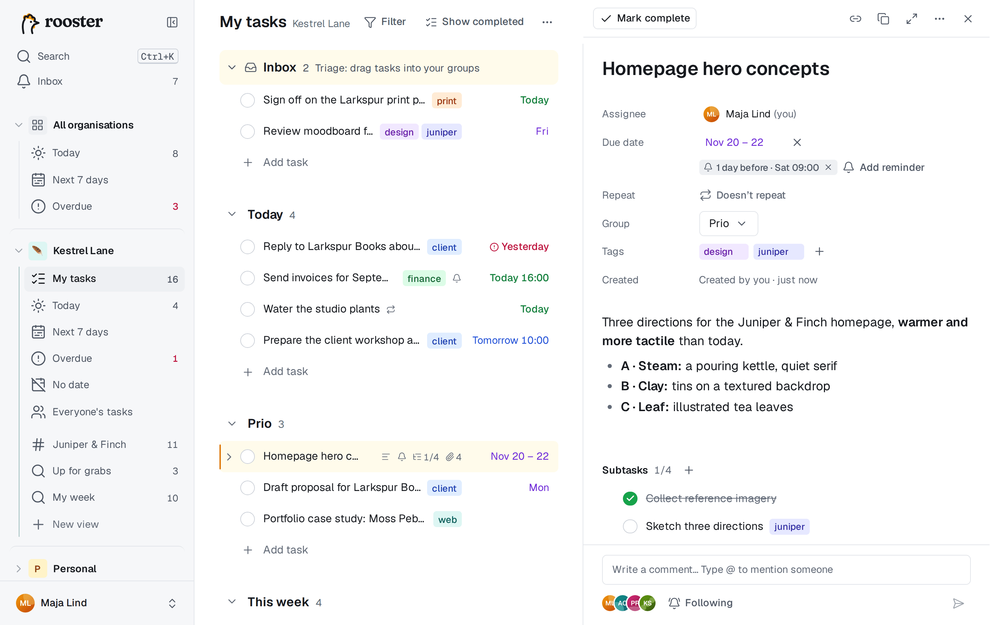

<h1>
  <picture>
    <source media="(prefers-color-scheme: dark)" srcset="apps/web/public/icons/wordmark-dark.svg">
    
  </picture>
</h1>

A self-hosted, keyboard-first task manager: a calm "My tasks" list for you and a small team, on your own server.

**[Website](https://ebner.github.io/rooster/)** · [User guide](https://ebner.github.io/rooster/guide/) ([svenska](https://ebner.github.io/rooster/sv/guide/)) · [Operator guide](docs/operator.md) · [Changelog](CHANGELOG.md)



- **The list is a text editor.** Type a task, press Enter, type the next. Everything works from the keyboard, with undo and no dialogs.
- **Dates in plain words**, in English and Swedish (`fri at 14`, `om 3 dagar`, `every mon`), with reminders, recurring tasks and smart views.
- **Together:** shared organisations next to your personal one, assignees, comments with @mentions, an inbox, push and email.
- **On your phone:** an installable app that reads offline and queues your edits.
- **In the terminal and for AI agents:** the `rooster` CLI and TUI, and MCP with OAuth, where you choose what an agent may do.
- **Self-hosted and private:** one Docker container, one SQLite file, OIDC sign-in, nightly backups, no telemetry.

## Quick start

You need Docker, a domain with HTTPS behind a reverse proxy, and a Google or OIDC client for sign-in ([sign-in setup](docs/oidc-setup.md)).

```sh
mkdir rooster && cd rooster
curl -fsSLO https://raw.githubusercontent.com/ebner/rooster/main/compose.yaml
curl -fsSL https://raw.githubusercontent.com/ebner/rooster/main/apps/server/.env.example -o .env
# set ROOSTER_BASE_URL, ROOSTER_AUTH_SECRET (openssl rand -base64 48), ROOSTER_ADMIN_EMAILS and a sign-in provider
docker compose up -d
```

Point your reverse proxy at `127.0.0.1:3000` ([Apache](docker/proxy/apache.conf), [nginx](docker/proxy/nginx.conf), [Caddy](docker/proxy/Caddyfile), [Traefik](docker/proxy/traefik-labels.yaml)) and sign in with an admin email. Upgrade with `docker compose pull && docker compose up -d`: migrations run automatically, after an automatic backup. The [operator guide](docs/operator.md) covers every setting, backups, upgrades and monitoring. CLI binaries for Linux, macOS and Windows are on each [release](https://github.com/ebner/rooster/releases).

## Development

Node 24 and pnpm (through corepack):

```sh
pnpm i
cp apps/server/.env.example apps/server/.env   # set ROOSTER_AUTH_SECRET, uncomment the mock IdP block
pnpm dev:idp                                   # mock OIDC provider on :9400
pnpm dev                                       # server :3000 + web :5173
```

Open http://localhost:5173 and use *Dev login*. `pnpm run ci` runs the whole pipeline. See [CONTRIBUTING](CONTRIBUTING.md), [AGENTS.md](AGENTS.md), the [specification](docs/spec/00-overview.md) and the [decisions](docs/adr/). Report vulnerabilities privately as described in [SECURITY](SECURITY.md).

## License

Copyright © 2026 Hannes Ebner.

rooster is free software under the [GNU Affero General Public License v3.0 only](LICENSE) (`AGPL-3.0-only`). If you run a modified version for other people over a network, the license requires you to offer them its source.

**Additional permission under GNU AGPL version 3 section 7.** If you modify this program, or any covered work, by linking or combining it with the Bun runtime (or a modified version of it), including the libraries Bun links into its executables, containing parts covered by the terms of their own licences, the licensors of this program grant you additional permission to convey the resulting work. Corresponding Source for a non-source form of such a combination shall include the source code for the parts of the Bun runtime used as well as that of the covered work. This is what lets the single-file CLI binaries embed Bun.

Third-party software in the image and the CLI is listed with its licences in [THIRD-PARTY-NOTICES.txt](THIRD-PARTY-NOTICES.txt).
