<h1>
  <picture>
    <source media="(prefers-color-scheme: dark)" srcset="apps/web/public/icons/wordmark-dark.svg">
    
  </picture>
</h1>

A self-hosted, keyboard-first task manager: a calm "My tasks" list for you and a small team, on your own server.

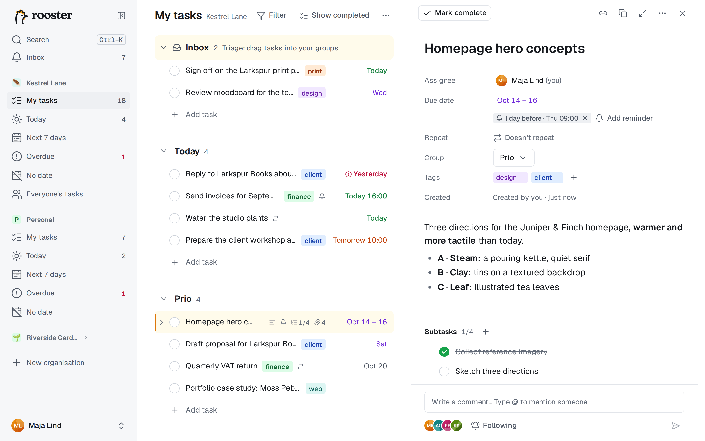

## What it does

- **The list is a text editor.** Type a task, press Enter, type the next. Rename, re-date, tag, move and complete without leaving the keyboard, and undo anything. No dialogs.
- **Your own groups,** like *Today*, *Prio* and *This week*, in exactly the order you choose. Drag and drop, or move with the keyboard. New work from others lands in an Inbox at the top.
- **Dates in plain words,** in English and Swedish: `Call the bank fri at 14`, `next week`, `om 3 dagar`, `12 okt`. Start dates for ranges, and smart views for Today, Next 7 days, Overdue and No date.
- **Recurring tasks:** `every mon`, `varannan vecka`, `every 3 days after done`. The next one appears directly below the one you completed.
- **Reminders:** `!1h` in a title, or the picker. They arrive in the inbox, as a push and by email.
- **A detail pane** for Markdown descriptions, subtasks, attachments (with thumbnails and a viewer) and the conversation.
- **Collaboration:** shared organisations next to your personal one, assignees, Everyone's tasks, comments with @mentions, followers and an inbox.
- **Notifications** in the app, as Web Push per device and by email, with a daily digest and a per-event matrix.
- **Phone app and offline:** an installable PWA with swipe gestures, a bottom bar and a FAB. It reads offline and queues your edits until you're back.
- **Search and a command palette** (Ctrl/⌘+K) for tasks, comments and every action, also offline.
- **Calendar feeds:** a secret iCal link for Google Calendar, Apple Calendar or Outlook.
- **Terminal:** the `rooster` CLI with natural-language dates and JSON output, plus a full-screen TUI.
- **AI agents:** a remote MCP server at `/mcp` with OAuth, where you choose on a consent screen what an agent may read and change. Also a local `rooster mcp` and an agent skill.
- **Self-hosted and private:** one Docker container, one SQLite volume, OIDC sign-in (Google, Keycloak, Authentik …), nightly backups, export, no telemetry. English and Swedish throughout.

## A closer look

| | |
|---|---|
| 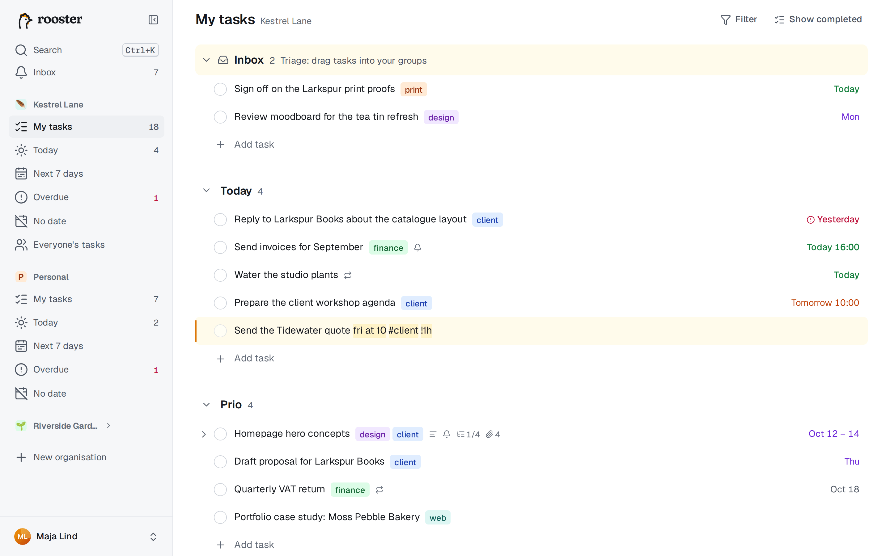 | 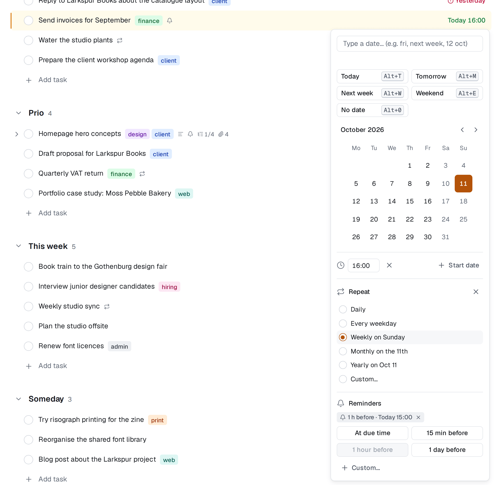 |
| Dates, tags and reminders go right into the title. | The date picker: quick picks, a calendar, a time, Repeat and Reminders. |
| 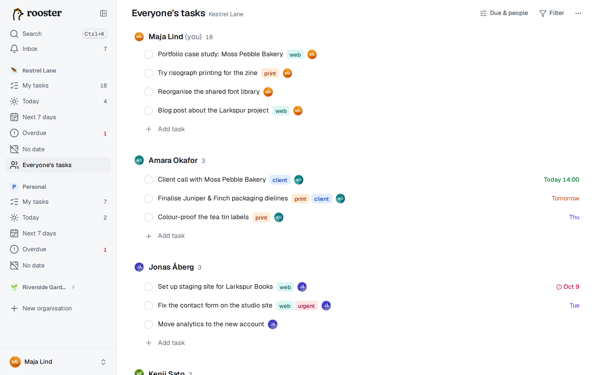 | 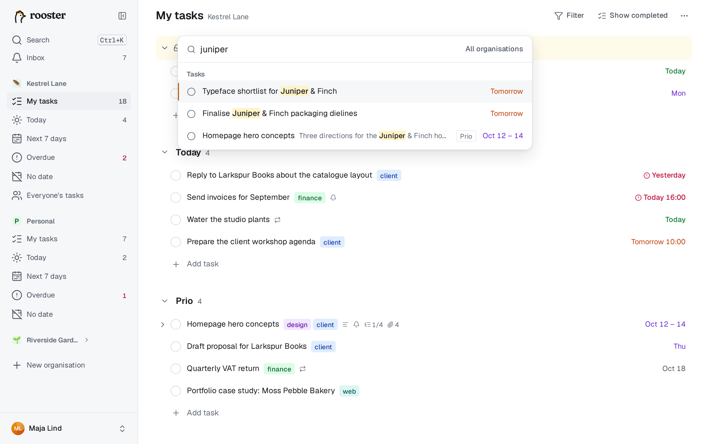 |
| Everyone's tasks in a shared organisation. | The command palette searches and runs actions. |
| 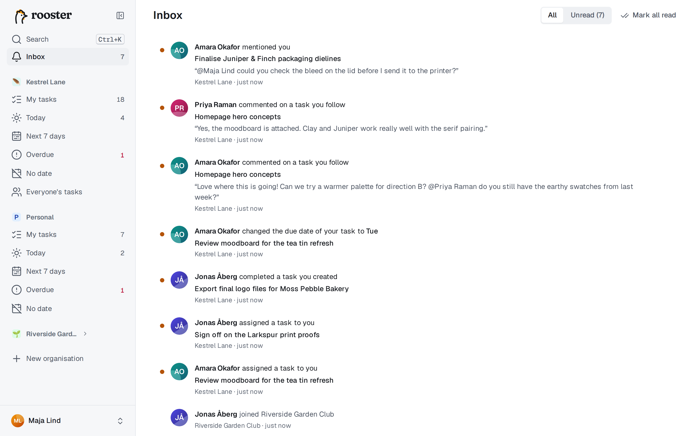 | 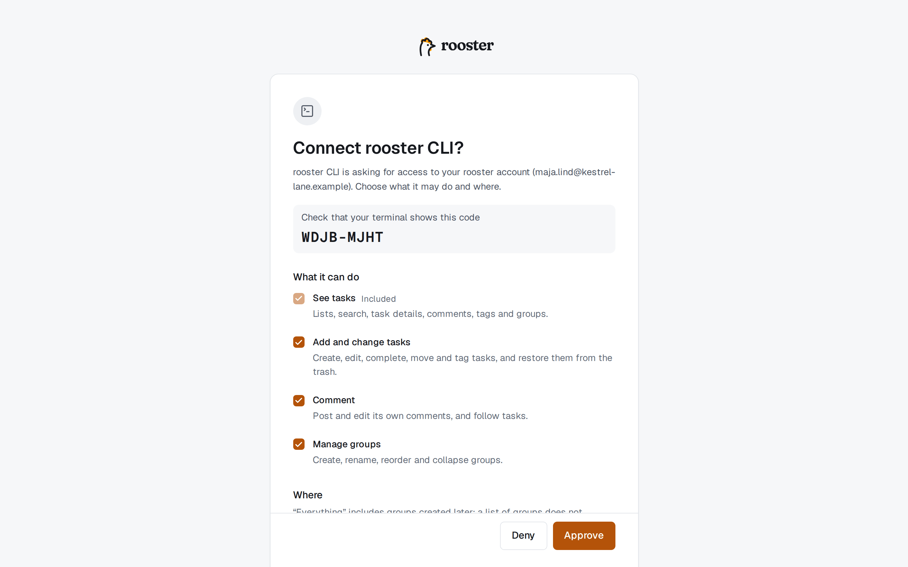 |
| The inbox. | Connecting the CLI or an AI agent: you choose what it may do and where. |

<p>
  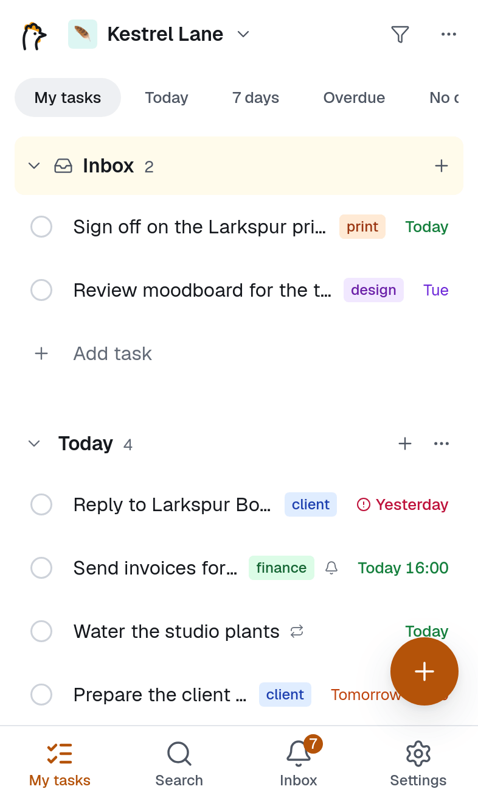
  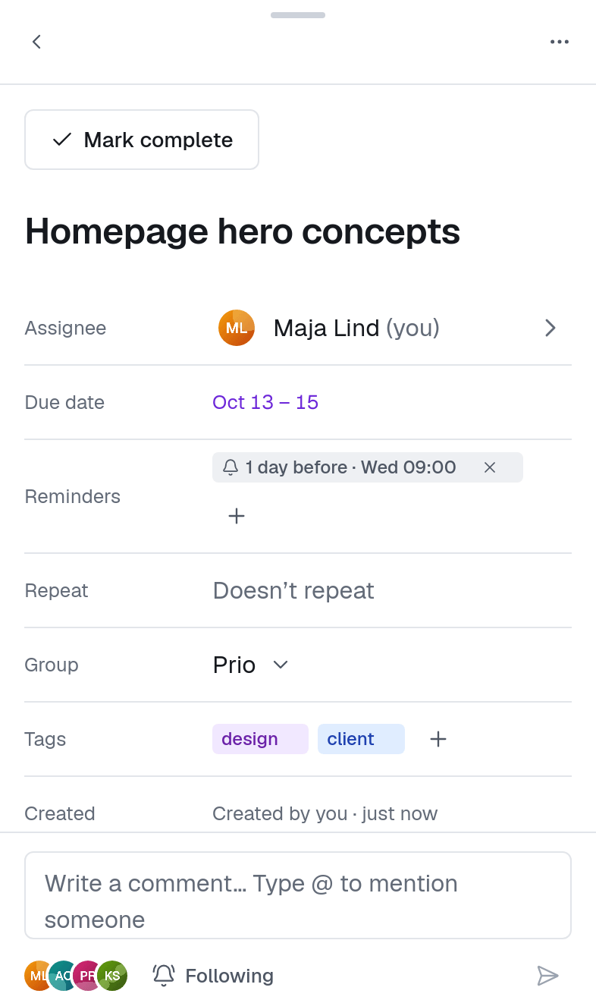
  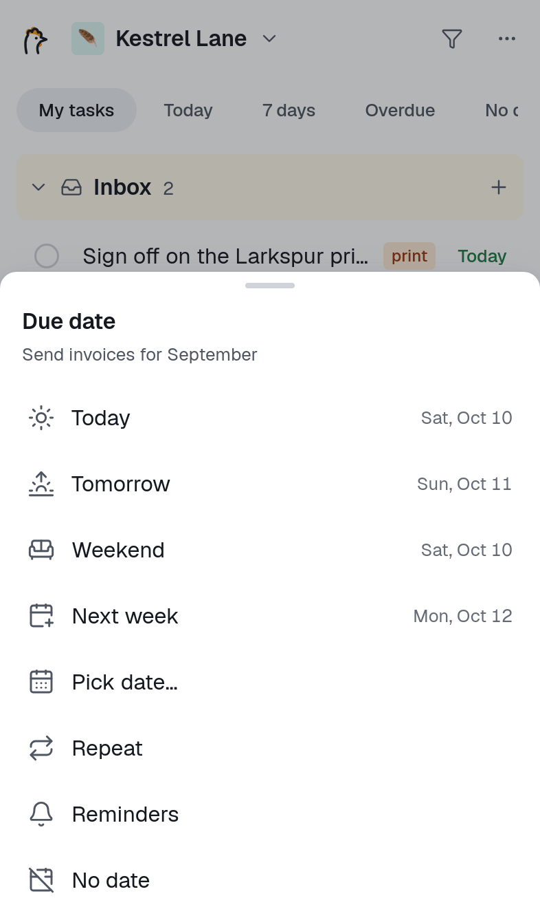
  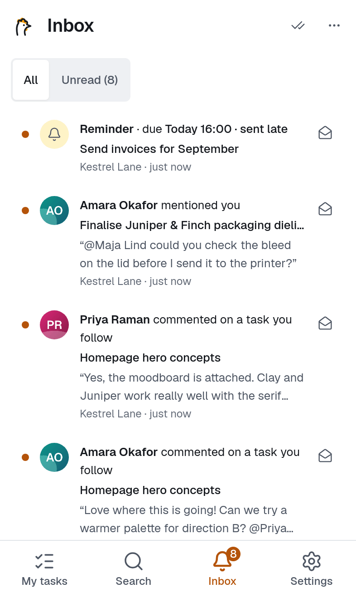
</p>

The people and companies in the screenshots are made up. They come from a seeded demo team, see [CONTRIBUTING](CONTRIBUTING.md#screenshots).

## Quick start (Docker Compose)

You need Docker, a domain with HTTPS behind a reverse proxy, and a Google or OIDC client for sign-in.

1. Get the compose file and the configuration template:

   ```sh
   mkdir rooster && cd rooster
   curl -fsSLO https://raw.githubusercontent.com/ebner/rooster/main/compose.yaml
   curl -fsSL https://raw.githubusercontent.com/ebner/rooster/main/apps/server/.env.example -o .env
   ```

2. Edit `.env`. The required values are:

   ```env
   ROOSTER_BASE_URL=https://rooster.example.com
   ROOSTER_AUTH_SECRET=        # openssl rand -base64 48
   ROOSTER_ADMIN_EMAILS=you@example.com
   # plus one sign-in provider, e.g.
   ROOSTER_GOOGLE_CLIENT_ID=…
   ROOSTER_GOOGLE_CLIENT_SECRET=…
   ```

   [Sign-in setup](docs/oidc-setup.md) walks through Google, Authentik and Keycloak. The redirect URI is `${ROOSTER_BASE_URL}/api/auth/callback/<provider id>`.

3. Start it:

   ```sh
   docker compose up -d
   docker compose logs -f rooster   # a config problem lists every issue and exits with code 78
   ```

4. Point your reverse proxy at `127.0.0.1:3000` (snippets for [Apache](docker/proxy/apache.conf), [nginx](docker/proxy/nginx.conf), [Caddy](docker/proxy/Caddyfile) and [Traefik](docker/proxy/traefik-labels.yaml)), open `ROOSTER_BASE_URL` and sign in with an admin email.

5. On a phone, open the same address and choose *Add to Home Screen* (iPhone) or *Install app* (Android).

Upgrade with `docker compose pull && docker compose up -d`: migrations run automatically, after an automatic backup. The [operator guide](docs/operator.md) covers every setting, the reverse proxy, backups and restore, upgrades and monitoring.

## Command line and AI agents

```sh
rooster login --server https://rooster.example.com   # approve in the browser, choosing what the CLI may do
rooster add "Pay the invoice fri #finance >Prio !1h"
rooster today
rooster done 42
rooster                                               # the full-screen TUI
rooster mcp setup --client claude-code                # a separate, narrower login for an AI agent
```

Single-file binaries for Linux, macOS and Windows are attached to each [GitHub release](https://github.com/ebner/rooster/releases). Remote agents only need `https://<your rooster>/mcp`. More in [Terminal app, command line and AI agents](docs/guide/en/cli-tui-mcp.md).

## Documentation

- **User guide:** [English](docs/guide/en/getting-started.md) · [Svenska](docs/guide/sv/getting-started.md). It's also built into the app at `/help` (**Open the guide** in the user menu, Settings or the `?` cheat sheet), and works offline.
- **[Operator guide](docs/operator.md):** installing, configuring and running an instance.
- **[Sign-in setup](docs/oidc-setup.md):** Google and OIDC providers.
- **[Changelog](CHANGELOG.md):** what changed in each release, with upgrade notes.
- **[Security](SECURITY.md):** how to report a vulnerability privately.
- **[Contributing](CONTRIBUTING.md):** development setup, tests, conventions and how to regenerate the screenshots.
- **The specification** in [`docs/spec/`](docs/spec/00-overview.md) and the decisions in [`docs/adr/`](docs/adr/). The REST API is documented live at `/api/docs`.

## Development

Node 24 and pnpm (through corepack):

```sh
pnpm i
cp apps/server/.env.example apps/server/.env   # set ROOSTER_AUTH_SECRET, uncomment the mock IdP block
pnpm dev:idp                                   # mock OIDC provider on :9400
pnpm dev                                       # server :3000 + web :5173
```

Open http://localhost:5173 and use *Dev login*. `pnpm run ci` runs the whole pipeline. See [CONTRIBUTING](CONTRIBUTING.md) and [AGENTS.md](AGENTS.md).

## License

Copyright © 2026 Hannes Ebner.

rooster is free software under the [GNU Affero General Public License v3.0 only](LICENSE) (`AGPL-3.0-only`). If you run a modified version for other people over a network, the license requires you to offer them its source.

**Additional permission under GNU AGPL version 3 section 7.** If you modify this program, or any covered work, by linking or combining it with the Bun runtime (or a modified version of it), including the libraries Bun links into its executables, containing parts covered by the terms of their own licences, the licensors of this program grant you additional permission to convey the resulting work. Corresponding Source for a non-source form of such a combination shall include the source code for the parts of the Bun runtime used as well as that of the covered work. This is what lets the single-file CLI binaries embed Bun.

Third-party software in the image and the CLI is listed with its licences in [THIRD-PARTY-NOTICES.txt](THIRD-PARTY-NOTICES.txt).
