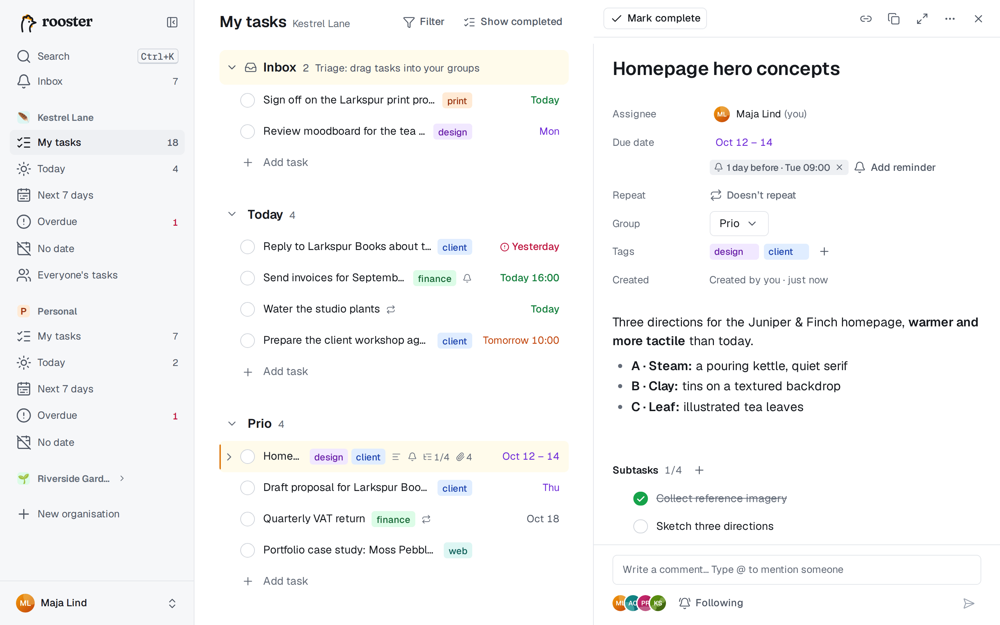
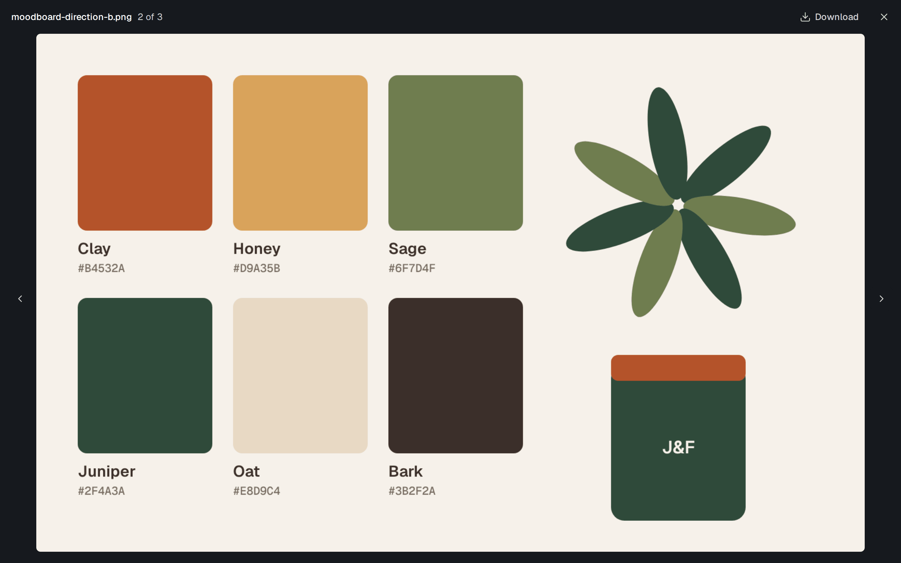

# Attachments

Attach screenshots, documents and other files to any task. They appear in the **Attachments** section of the task pane, below the subtasks.

## Add files

Open the task (click the row, or press `O`), then do one of these:

- **Drop** files anywhere on the pane. "Drop to attach" appears while you drag.
- **Paste** an image, for example a screenshot you just took, while the pane has focus. It is saved as "Pasted image" with the date and time.
- **Choose** files with **Attach files**, or with **choose files** when the task has none yet.

Each upload shows its progress, and you can cancel it. If one fails, the message says why, with **Retry** where that helps.

On a phone, open the task and use **Attach files** to pick photos or files.

## Images and other files

- **Images** get a thumbnail. Click one to open it in the image viewer: `←` and `→` go to the previous and next image, `Esc` closes it, and **Download** saves the original.
- **Other files** are listed with their size, who added them and when. Click one to download it.

rooster checks what a file really is. A file whose content doesn't match its name, for example a program renamed to `.pdf`, is refused.

## Delete a file

Use the trash icon next to the file, then confirm with **Delete**. Deleting an attachment can't be undone. You can delete files you added yourself, and any file on a task assigned to you.

## Limits

- One file can be at most **25 MB** unless your administrator has changed the limit. A file that is too large is refused before it is sent, and the message gives the limit.
- A task can have at most **100** attachments.
- Your administrator may also set a **storage quota**: the total size of the files you have uploaded. Files on tasks in the Trash still count until the Trash is emptied (after 30 days, or when someone deletes them permanently). An upload that would go over the quota is refused, and nothing is stored.

## Offline

Attachments need a connection. While you are offline, the section says so, and you can add or delete files again once you are back online.

## Who can see attachments

Everyone who can see the task can see and download its files. Attachments are not copied when a task is duplicated or when a repeating task creates its next instance.

Your profile picture is set elsewhere: see [Settings and your data](./settings-and-data.md#profile).
