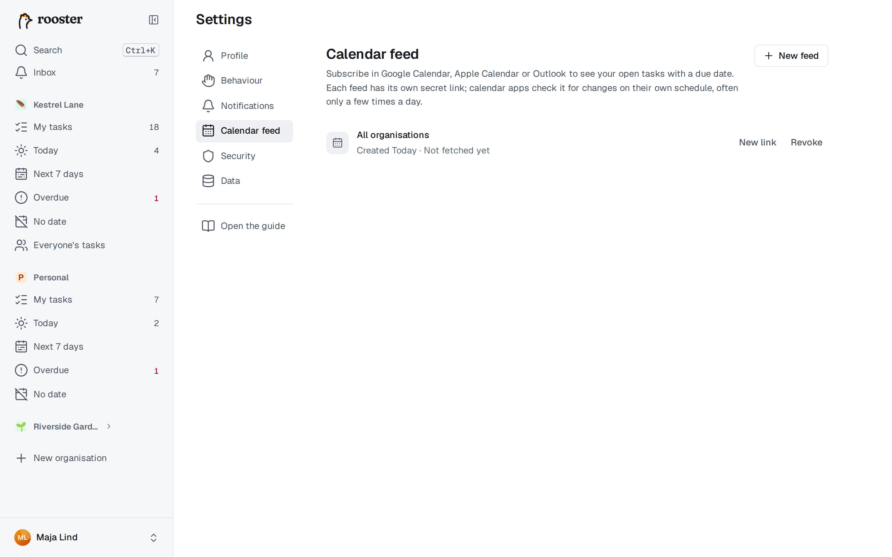

# Calendar feeds

A calendar feed puts your due dates into the calendar app you already use: Google Calendar, Apple Calendar, Outlook or any app that can subscribe to a calendar by URL. The feed is read-only: you still change tasks in rooster.

## Create a feed

1. Open **Settings → Calendar feed** and choose **New feed**.
2. Under **Tasks from**, pick one organisation, or **All organisations**.
3. Choose **Create feed**.
4. Copy the link with **Copy link**, or use **Subscribe** to hand it straight to your computer's or phone's calendar app.

The link is shown only this once. If you lose it, get a new one (see below). You can have up to 10 feeds, for example one per organisation.

## Subscribe in your calendar app

- **Google Calendar** (on the web): next to *Other calendars* choose **+** → **From URL**, paste the link and choose **Add calendar**. The feed then also shows up in Google Calendar on your phone.
- **Apple Calendar** on a Mac: **File → New Calendar Subscription**, paste the link. On iPhone or iPad, **Subscribe** opens Calendar directly; otherwise go to *Settings → Apps → Calendar → Calendar Accounts → Add Account → Other → Add Subscribed Calendar*.
- **Outlook:** **Add calendar → Subscribe from web**, paste the link.

The exact menu names vary between versions of these apps.

## What's in the feed

- Your **open tasks assigned to you that have a due date**, subtasks included, from 90 days ago onwards.
- A task with only a date becomes an **all-day event**. A task with a due time becomes a **30-minute event** at that time.
- Each event's title starts with ☐, and its description links back to the task in rooster.
- Completed and deleted tasks drop out of the feed.

## How quickly changes show up

rooster refreshes a feed at most every 15 minutes. Calendar apps check for changes on their own schedule, often only a few times a day; Google Calendar can take up to a day. A change you make in rooster therefore takes a while to appear in your calendar.

## Keep the link secret

Anyone who has the link can see the titles and due dates of the tasks in it, without signing in. Treat it like a password.

- **New link** replaces the link: the old one stops working at once, and calendars subscribed to it need the new one.
- **Revoke** turns the feed off for good. Calendars subscribed to it stop getting updates.

Each feed shows when a calendar app last fetched it, so you can see whether it's in use.
