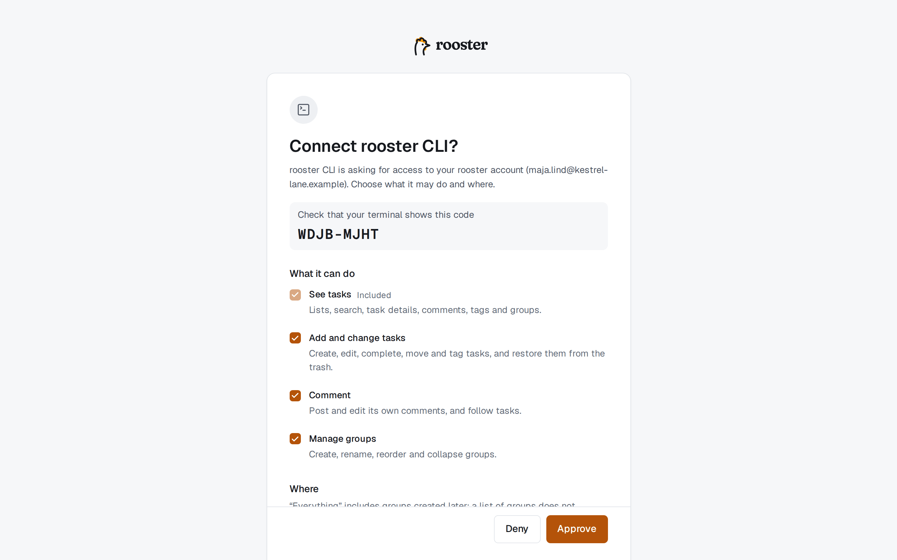
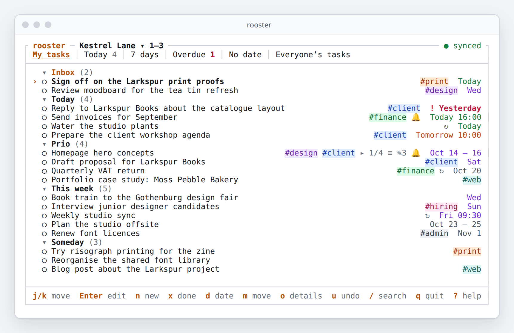
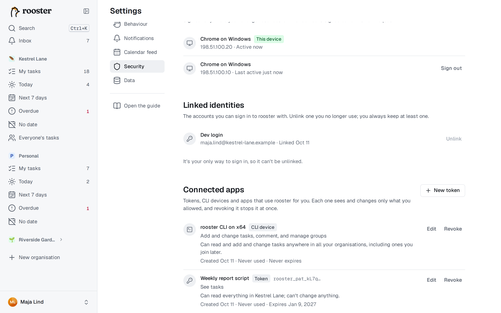

# Terminal app, command line and AI agents

The `rooster` command line tool works with your tasks from a terminal and from scripts. It also has a full-screen terminal app (a TUI), and it connects AI agents such as Claude to rooster through MCP. You decide exactly what each of them may see and change.

## Install the command line tool

- **Single-file binary:** download `rooster-<version>-<platform>` for Linux (x64, arm64), macOS (Apple silicon, Intel) or Windows (x64) from the project's release page, make it executable (`chmod +x`), and put it on your `PATH` as `rooster`. Each file has a `.sha256` checksum next to it.

Check it with `rooster --version`.

## Sign in

```sh
rooster login --server https://rooster.example.com
```

1. The tool shows a code and opens rooster's **Connect a device** page in your browser. On a machine without a browser, add `--no-browser` and open the printed address on any device, your phone included.
2. Type the code shown in the terminal and choose **Continue**. Check that the page shows the same code, then choose what the command line may do and where: which organisations, and which groups it may read and change. See [What a connection may do](#what-a-connection-may-do).
3. Choose **Allow**. The terminal continues on its own, and your Inbox gets a note that a device was connected.

Only enter a code that you just got from your own terminal or app. rooster never asks you for a code by mail, chat or phone; someone who does is trying to get into your account.



The login is stored in your system's keychain, or in a file only you can read where there is no keychain. `rooster whoami` shows who you are signed in as and what the login may do; `rooster logout` signs out and revokes the login.

- **Several servers or accounts:** add `--profile work` to any command. Settings live in `~/.config/rooster/config.toml`.
- The login renews itself in the background. After about a month unused, sign in again.
- **For scripts and CI:** pipe a personal access token into `rooster login --with-token`, or set `ROOSTER_TOKEN`. `ROOSTER_SERVER`, `ROOSTER_ORG` and `ROOSTER_PROFILE` also override the settings, and `NO_COLOR` turns colours off.

## Everyday commands

```sh
rooster today                     # due today or overdue; also: rooster week, rooster ls overdue
rooster ls                        # My tasks, by group
rooster add "Book dentist fri #health >Today"
rooster add "Send invoice tomorrow 14:00 !1h"           # with a reminder an hour before
rooster add "Water the plants every mon"                # a repeating task
rooster add "Plan the offsite" --due "next week" --repeat "every month"
rooster done 42 57                # complete tasks 42 and 57
rooster mv 42 --group Prio --bottom
rooster show 42                   # description, subtasks, tags, reminders, attachments, comments
rooster edit 42 --editor          # write the description in $EDITOR
rooster tag 42 +urgent -later
rooster sub 42 "Call the bank"    # a subtask
rooster comment 42 "Sent the draft"
rooster search "invoice #finance"
rooster open 42                   # open the task in the browser
```

- **Always quote titles.** Unquoted, the shell treats `#` as a comment and `>` as a redirect.
- Titles understand the same [dates, repeats](./dates-and-repeats.md), `#tags`, `>Group`, `@person` and [`!1h` reminders](./reminders.md) as the app. Add `--no-parse` to keep the title exactly as typed.
- `rooster rm 42` moves a task to the Trash, and `rooster restore 42` brings it back. For a repeating task, `--occurrence` deletes only this one and creates the next.
- `rooster group …` and `rooster tag ls|add|rm` manage groups and tags; `rooster org ls` and `rooster org use <slug>` list organisations and pick the default one; `--org <slug>` works on any command.
- `rooster completion bash` (or `zsh`, `fish`, `powershell`) prints shell completions, including your group and tag names.
- Run `rooster <command> --help` for every option.

### Referring to tasks

| You type | Means |
|---|---|
| `42` | Task 42 in the current organisation (the number in every listing) |
| `personal#42` | Task 42 in another organisation |
| `0192f3a0` | A task ID, or the first 8 or more characters of one |
| `@last` | The task you last added or showed |
| `-` | Read the references from standard input, one per line |

### In scripts

Add `--json` to get structured output, or `--quiet` to print only references:

```sh
rooster ls overdue --json | jq -r '.[].seq' | rooster done -
```

The exit code tells scripts what happened: `0` ok, `2` usage error, `3` not signed in or not allowed, `4` not found, `5` conflict or invalid, `6` network or server problem.

## The terminal app (TUI)

Run `rooster` with no arguments in a terminal to open a full-screen, keyboard-only version of rooster: a text user interface, or TUI. It shows the same views and organisations as the web app, and updates live when something changes elsewhere. It uses the sign-in from [Sign in](#sign-in), and `--profile` picks another one. Where a terminal can't tell the web's keys apart, it uses its own, much like vim's.



| Keys | Action |
|---|---|
| `j` `k` or `↓` `↑` | Move between rows |
| `←` / `→` | Collapse / expand a group or a task’s subtasks |
| `Home` / `End` · `PgUp` / `PgDn` | First / last row · scroll a page |
| `Enter` or `i` | Edit the title |
| `n` / `N` | New task below / above |
| `x` | Complete or reopen |
| `d` | Date, repeat or reminder: `fri 14:00`, `every mon`, `!1h`, or `none` |
| `t` · `m` · `s` | Tags · move to a group · add a subtask |
| `o` / `e` | Open the details / edit the description in `$EDITOR` |
| `J` `K` · `]` `[` | Move the task down, up · to the next or previous group |
| `Delete` | Delete the task (with undo) |
| `u` / `Ctrl+R` | Undo / redo |
| `/` | Search |
| `g` then `m` `t` `w` `o` `n` `e` | My tasks, Today, Next 7 days, Overdue, No date, Everyone's tasks |
| `1`–`9` | Switch organisation |
| `H` | Show or hide completed tasks |
| `?` | All keys, and how they differ from the web |
| `q` | Quit |

The terminal app needs a connection; without one, changes fail and `r` retries them.

## AI agents (MCP)

rooster speaks MCP, the protocol AI assistants use to work with other tools. Connected, an agent can plan your day with you, add and complete tasks, move them between groups, comment and read your Inbox, within the limits you set.

### Remote: add rooster's address

In an agent or app that supports remote MCP servers, add:

```
https://<your rooster>/mcp
```

The agent finds everything else on its own. Your browser then opens rooster's approval page, which shows who is asking and where you will be sent back to. Choose what it may do (see below), then **Allow**. If the agent later needs more, for example to post comments, it asks again and the new capabilities are marked **New**.

### Remote, from a machine without a browser

Agents normally sign in to `https://<your rooster>/mcp` through a browser window on the same machine. On a server, over SSH or in a container there is none. Two ways work there:

- **With the rooster command line installed:** `rooster mcp setup --remote --client claude-code` signs the agent in with a code you approve on any device, and prints the command that adds rooster to Claude Code. Claude Code then asks `rooster mcp header` for a fresh key whenever it connects.
- **With any agent:** create an **MCP token** (see [Personal access tokens](#personal-access-tokens)) and give it to the agent as a header. rooster shows the lines to paste for Claude Code and Codex.

### Local: `rooster mcp setup`

For agents that run on your computer, such as Claude Code, Claude Desktop or Cursor:

```sh
rooster mcp setup --client claude-desktop   # or cursor; claude-code prints the command to run
rooster mcp setup                            # prints the configuration to paste anywhere
```

This creates a separate login for the agent (the `agent` profile), approved on the same page, so the agent never uses your own, broader command-line login. Add `--allow-delete` only if the agent should be able to delete tasks. Restart the agent app afterwards.

### Teach the agent rooster

`rooster skill install` installs the rooster skill, which explains rooster's groups, views and good habits to the agent (`--target agents` for agents that read `.agents/`, `--project` for the current project only). Every rooster server also publishes it, so a remote agent can find it by itself.

### Safety

- Agents treat task titles, descriptions and comments as data. They don't follow instructions written in them.
- An agent can delete only if you ticked **Allow deleting tasks**, and deleted tasks go to the Trash, where you can restore them for 30 days.
- Everything an agent changes appears in the task's activity, so you can see what it did.

## What a connection may do

The same approval page is used for the command line, AI agents and personal access tokens.

- **What it can do:** See tasks · Add and change tasks · Comment · Assign to others · Manage groups · Read notifications, and Delete only with **Allow deleting tasks**.
- **Where:** all organisations, or chosen ones. Per organisation, it may read **Everything** or **Only these groups**, and change **Nothing**, **Everything** or **Only these groups**. "Everything" includes groups created later; a list of groups does not.
- **Expires:** in 7, 30 or 90 days, in 1 year, never, or for apps **This session only** (it ends after a day unused).

Something it may not do is refused, and the agent is told to ask you to widen its access.

## Personal access tokens

A token lets a script use rooster without signing in interactively. Create one in **Settings → Security → Connected apps → New token**, or from a signed-in terminal:

```sh
rooster token create backup --scope tasks:read --expires 30d
```

The token is shown once. Use it as `Authorization: Bearer <token>`, or with `rooster login --with-token`.

A token works either with the **API** (scripts, the command line) or with **MCP** (AI agents), chosen under **Works with** when you create it, or with `--audience mcp`. An MCP token only works at `https://<your rooster>/mcp`, and after creating one rooster shows the setup lines for common agents. An MCP token can't ask for more access by itself: if the agent needs more, edit the token in Connected apps.

## See and revoke access

**Settings → Security → Connected apps** lists every token, command-line login and app connected to your account, with what it may do and when it was last used. **Edit** narrows it; **Revoke** stops it at once. From a terminal: `rooster apps ls` and `rooster apps revoke <id>`.


