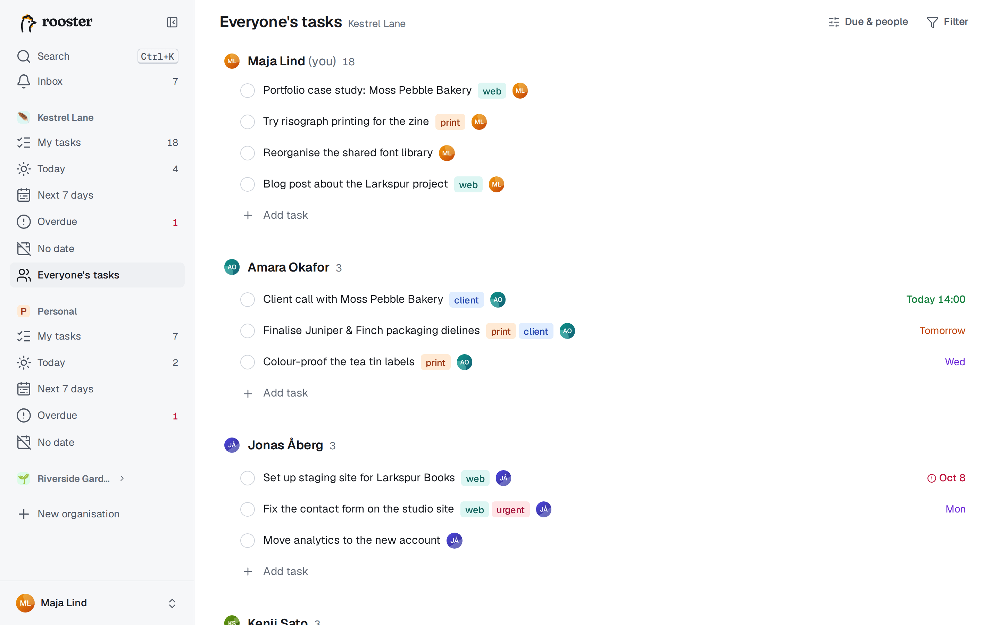
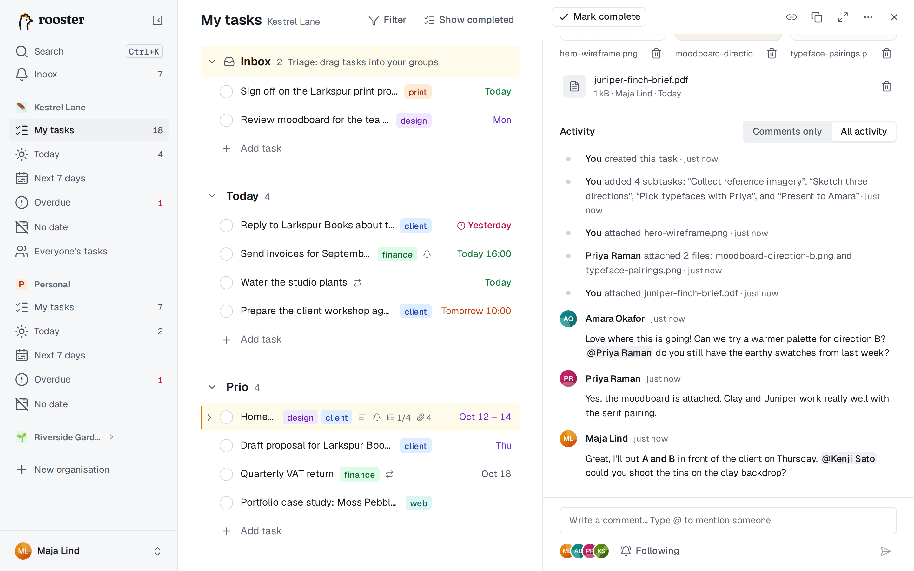
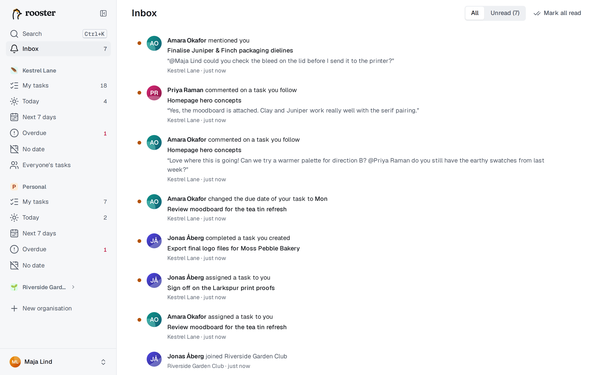

# Working together

In a shared organisation, members see every task in it, assign tasks to each other, comment and follow along. Your Personal organisation has none of this: it's only yours.

## Members and roles

There are two roles:

- **Owners** change the organisation's name, icon and colour, invite people, change roles, remove members and can delete the organisation. Every organisation keeps at least one owner.
- **Members** see and work on all tasks in the organisation.

Everyone has their own groups and their own My tasks; nobody can rearrange yours. Members and roles are in **Organisation settings** (the organisation's **⋯** menu in the sidebar). A member can leave under **Danger zone**. When someone leaves or is removed, their tasks there become unassigned.

## Invite people

1. Open the organisation's **⋯** menu and choose **Invite people**.
2. Choose **Email invite** to invite one address, or **Invite link** to get a link. A link can be used **Once** or **Many times**, and expires after the number of days you pick.
3. Choose the role and create the invite. If the server sends email, the person gets the invite by mail; you can always copy the link and send it yourself.

Open invites are listed below, where you can revoke them. When someone joins, you get a notification.

## Assign tasks

A task has at most one assignee. It appears in **their** My tasks.

- Select a task and press **A** (or **Tab+A** while editing), then pick a person.
- Type `@name` in a title while you create a task: `Draft the poster @mei`.
- Use the **Assignee** line in the detail pane.
- Select several tasks and choose **Assign** in the bar at the bottom.

When you assign a task to someone else, it leaves your list and lands at the top of **their Inbox**; the toast offers Undo. You can also remove the assignee; the task then shows only under *Unassigned* in Everyone's tasks (and under its parent, if it's a subtask). Rows of subtasks assigned to someone else show their avatar.

## Everyone's tasks

**Everyone's tasks** (G then E) shows all open tasks in the organisation: a section per person, you first, then the others alphabetically, then **Unassigned**. Each section is sorted by due date.

- **Filter** by tag, and **Due & people** by due date (any, overdue, next 7 days, no date) and by person.
- **Add task** under a person creates a task for them, in their Inbox.
- **Drag** a task to another person's section to reassign it. That's the only kind of drag here.

## Comments and mentions

The bottom of the detail pane is the activity feed with a comment box.

- Write a comment and post it with **Ctrl+Enter** (or Tab+Enter). **C** or **Tab+C** jumps to the comment box.
- Comments support **bold**, *italic*, `code`, code blocks, links and lists.
- Type `@` to mention a member; suggestions appear as you type. The person is notified and starts following the task.
- You can edit or delete your own comments from their menu. Edited comments are marked *edited*.
- Comments work offline and are sent when you're back online.

The feed mixes comments with what happened to the task: created, renamed, due date changed, assigned, completed or reopened, description edited, subtasks and files added. Changes made by the command line, an app or an AI assistant say so. Switch between **Comments only** and **All activity** at the top of the feed.

## Followers

Followers hear about comments on a task. You follow a task automatically when you create it, are assigned to it, comment on it or are mentioned in it. The followers are shown as avatars next to the comment box; use **Follow** / **Following** to start or stop following any task.

## The inbox

The **Inbox** in the sidebar (G then I; on phones, a tab in the bottom bar) collects your notifications, with an unread count:

- a task is assigned to you;
- someone comments on a task you follow;
- someone mentions you;
- someone completes a task you created;
- someone changes or removes the due date of your task;
- someone accepts your invite;
- your [reminders](./reminders.md).

Click a notification to open the task. Mark items read or unread one by one (**U**), or choose **Mark all read** (Shift+U). Switch between **All** and **Unread** at the top. You're never notified about your own changes, except for reminders.

Don't confuse this inbox of notifications with the **Inbox group** at the top of My tasks, where newly assigned tasks land.

To get notifications as push messages or email, or to turn some off, see [Notifications](./notifications.md).
