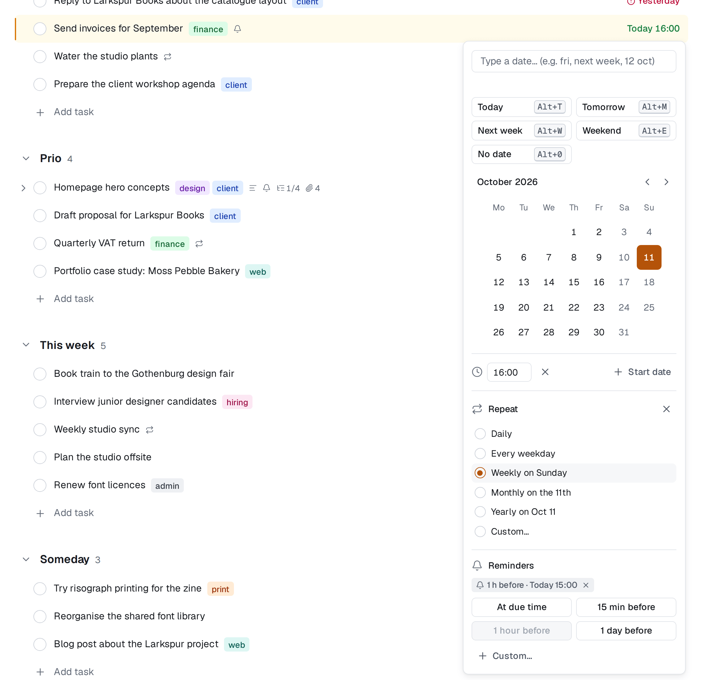
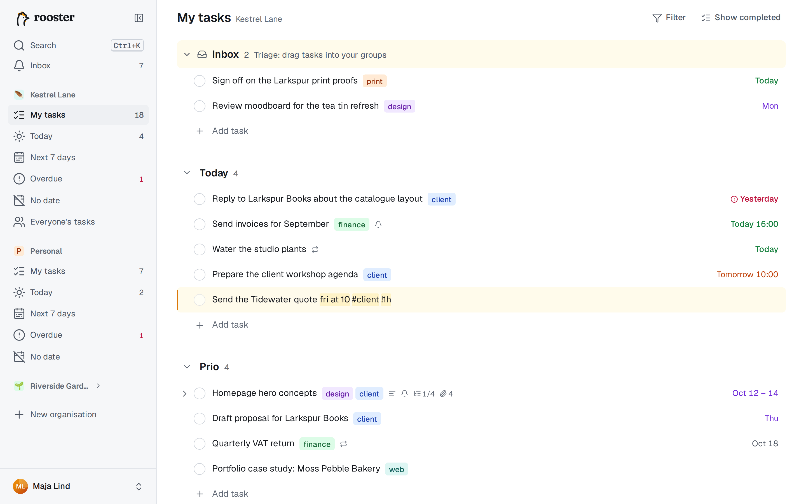

# Dates and repeating tasks

A task can have a due date, a due time, a start date and a repeat rule. You can set all of them by typing.

## Due dates and times

A due date is a calendar day, the same wherever you are. A due time is optional; with a time, the task is due at that moment in the time zone where it was set.

The date cell on the right of each row shows a short label:

| Label | Means |
|---|---|
| **Today**, **Tomorrow**, **Yesterday** | as it says |
| **Fri** | within the next week |
| **Oct 12** | later this year (or *12 Oct*, depending on your date format) |
| **Oct 12, 2027** | another year |
| **Today 14:00** | with a time (12- or 24-hour clock, per your setting) |
| **Oct 10 – 12** | with a start date |

The colour tells you how soon: overdue is red with a warning icon, today is green, tomorrow blue, this week violet, and later grey. A task due today at a time that has passed counts as overdue. Hover a label for the full date.

Your time zone, the first day of the week, the date format and the time format are in Settings → Profile.

## The date picker

Click the date cell, or press **D** (or **Tab+D** while editing), to open the date picker.

1. **Type a date** in the box at the top. A preview below it shows what you'll get, or *Can't understand that*. Press Enter to set it.
2. Or use a quick chip: **Today** (Alt+T), **Tomorrow** (Alt+M), **Next week** (Alt+W), **Weekend** (Alt+E) or **No date** (Alt+0). On a Mac, Alt is ⌥.
3. Or click a day in the calendar.

Choosing a date closes the picker straight away. Below the calendar:

- **Time** adds a due time, with suggestions every 15 minutes.
- **Start date** switches the calendar to a range: pick the start, then the due date. You can also type a range, such as `oct 10 - 12`. The start date can't be after the due date.
- **Repeat** makes the task repeat (see below).
- **Reminder** (Alt+R) adds reminders ([Reminders](./reminders.md)).

While Time or Start date is open, the picker stays open until you press Enter or click outside. Esc closes it without changes.

**To clear a date**, choose **No date**, select the date cell and press Backspace or Delete, or click the **×** next to the date in the detail pane. Undo puts it back.

## Typing dates in a title

Type a date at the end of a task's title and rooster picks it up: `Call the bank fri` becomes *Call the bank*, due Friday. The phrase is highlighted while you type and removed from the title when you press Enter.

**Where the phrase may be.** Weekdays, relative phrases (*next week*, *in 3 days*) and repeat phrases count only at the **end** of the title, optionally followed by a time, `#tags`, `@name` or a reminder. So *Call Bob mon* gets a date, but *Mon Repos hotel booking* doesn't. Unambiguous phrases (*today*, *tomorrow*, *12 oct*, *2026-10-12*) may be anywhere.

**When you don't want a date.** Click the highlight, or press Backspace right after it, and it stays plain text. Or wrap the words in backticks: `` Read `next week` magazine ``. The backticks are removed.

**Languages.** Titles understand English full words in any language setting, plus the short forms and Swedish words when your language is Swedish. The picker box always understands both languages in full. Numeric dates like `12/10` work only in the picker (read according to your date format), so *1/2 cup flour* stays a title.

### What you can type

| Meaning | English | Swedish |
|---|---|---|
| today | today, tod | idag, i dag |
| tomorrow | tomorrow, tom, tmr | imorgon, i morgon, imorn |
| day after tomorrow | – | övermorgon, i övermorgon |
| a weekday (the next one after today) | monday, mon, next mon, on fri | måndag, mån, nästa måndag, på fredag |
| a weekday, today included | this fri | – |
| next week (its first day) | next week | nästa vecka |
| the weekend (Saturday) | weekend, this weekend, next weekend | helgen, i helgen, nästa helg |
| the first of next month | next month | nästa månad |
| in a while | in 3 days, in 2 weeks, in a month, +3d, +2w, +1m | om 3 dagar, om två veckor, om en månad |
| a date | oct 12, 12 oct, october 12th, 12 oct 2027, 2026-10-12 | 12 okt, 12 oktober, den 12 oktober, 2026-10-12 |
| end of the period | end of week, end of month, eow, eom | slutet av veckan, slutet av månaden |
| with a time | fri at 14, fri at 14:30, fri 2pm, fri @ 9am | fre kl 14, fre kl. 14.30, fre klockan 9 |

A date without a year means the next time that date comes round. A time needs *at*, *@*, *kl* or *klockan* unless it has minutes or am/pm (`fri 14:30`). In the picker, a time on its own (`15:00`) means today at that time.

## Repeating tasks

A repeating task makes its next instance when you complete it.

### Set a repeat

- In the date picker or the pane's **Repeat** line, choose a preset: daily, every weekday, weekly on the due date's weekday, monthly on its day, or yearly on its date.
- Choose **Custom…** for anything else: every N days, weeks, months or years; chosen weekdays; on a day of the month or the first, second, third, fourth or last weekday; **Count from completion**; and when it **Ends**: **Never**, **On a date** or **After a number of times**.
- Or type it at the end of the title:

| English | Swedish |
|---|---|
| every day, daily | varje dag, dagligen |
| every weekday | varje vardag |
| every mon, every mon and thu | varje måndag, varje måndag och torsdag |
| every 2 weeks, every other fri | varannan vecka, varannan fredag |
| every 3 days | var tredje dag, var 3:e dag |
| every month, every month on the 15th | varje månad, den 15:e varje månad |
| every last fri | varje sista fredag |
| every year, oct 12 every year | varje år, 12 okt varje år |
| every 3 days after done | var 3:e dag efter klar |

A repeating task needs a due date. If you type only a repeat phrase, the first due date is the first matching day from today. Rows of repeating tasks show a ↻ icon.

### Count from completion

Normally the next date follows the rule from the due date: a task due every Monday stays on Mondays, even if you complete it on Wednesday. With **Count from completion** (or *after done*), the next date counts from the day you complete it: "every 3 days after done" is due three days after you last did it.

### What happens when you complete it

The next instance appears **directly below** the completed one, in the same group, for the same person. It gets the title, description, tags, followers and subtasks (reopened), and the reminders that are relative to the due date. Comments, attachments and reminders at a fixed time stay with the old one.

### Stop or delete

- Remove the repeat with **Stop repeating**, or remove the due date: either ends the series.
- Deleting a repeating task asks what you mean. **Delete this task** removes only this one, and the series continues with the next date. **Delete this and following** removes it and ends the series.
