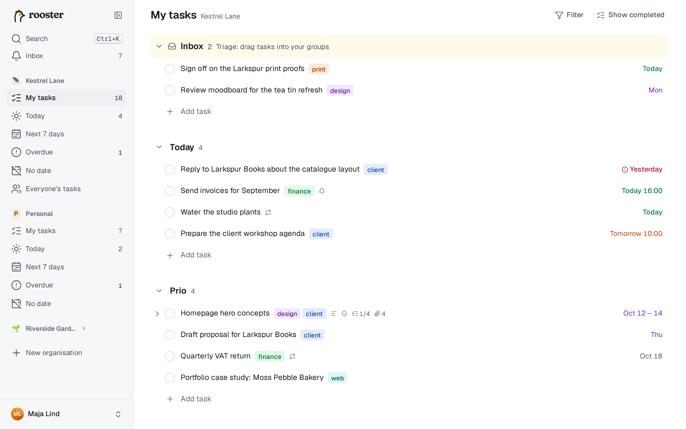

# Getting started

rooster is a calm, keyboard-first task list. It works like a text editor: you type a task, press Enter and type the next one. Dates, tags and groups go right into the title, and a side pane opens only when you want to write more.

## Sign in

1. Open the address of your rooster (your administrator gives it to you).
2. Choose **Continue with …** for your sign-in provider, for example Google or your company's single sign-on. rooster has no passwords of its own.
3. The first time, rooster creates your account, your **Personal** organisation and three groups: *Today*, *Prio* and *Upcoming*.

rooster is invite-only. If you see **You're not on the list yet**, your email address isn't allowed on this instance. Ask someone in your organisation for an invite link, or ask the administrator to add you. An invite link opens a page where you choose **Accept and sign in**.

## Organisations

Every task belongs to exactly one organisation. Use them to keep private and work tasks apart.

- **Personal** is yours alone. It can't be shared, renamed or deleted, and it has no collaboration features.
- **Shared organisations** have members who can see every task in them, assign tasks to each other and comment. See [Working together](./collaboration.md).

Each organisation is a section in the sidebar, with My tasks, the smart views (Today, Next 7 days, Overdue, No date) and, in shared organisations, Everyone's tasks. Drag an organisation's header to reorder the sidebar. **Ctrl+1** to **Ctrl+9** (⌘ on a Mac) jumps to My tasks of the first nine organisations.

To create an organisation, choose **New organisation** in the sidebar, give it a name, an icon and a colour, and press **Create organisation**. You become its owner. To invite people, open the organisation's **⋯** menu and choose **Invite people**.

On a phone, the organisation switcher sits at the top left; see [Phone and offline](./phone-and-offline.md).

## The list is a text editor

A row is either *selected* (you move around with the arrow keys) or *being edited* (there is a caret in the title).

| To | Do this |
|---|---|
| Start editing the selected row | Enter, F2 or I, or click the title |
| Add a task below / above | Enter / Shift+Enter while editing |
| Stop editing | Esc (the title is saved) |
| Move between rows | ↑ ↓ (or J and K) |
| Complete a task | Ctrl+Enter, or click the checkbox |
| Undo | Ctrl+Z |

Everything is saved as you type, and every change can be undone. Empty rows are never saved, so a stray Enter costs nothing.

## Your first five minutes

1. Click **Add task** under *Today* and type `Call the bank tomorrow`. The word *tomorrow* lights up: press Enter, and the task gets tomorrow's date while the word disappears from the title.
2. Type `Plan the week #work` and press Enter. A tag called *work* is created and attached.
3. Press Esc, then ↑ to select *Call the bank* and press **D** to open the date picker. Pick a day; the picker closes.
4. Press **M** and choose *Prio* to move the task to another group. Or drag it there.
5. Press **O** to open the task in the detail pane, and write a description or add subtasks.
6. Press Ctrl+Enter to complete it. The row fades out after a moment; Ctrl+Z brings it back.

## Where next

- [My tasks](./my-tasks.md): groups, subtasks, tags, moving and bulk changes.
- [Dates and repeating tasks](./dates-and-repeats.md): everything you can type as a date.
- [Views and search](./views-and-search.md): Today, Next 7 days and the command palette.
- [Keyboard shortcuts](./keyboard.md): the full list.

Press **?** anywhere in the list to see every shortcut. This guide is also in the app: choose **Open the guide** in the cheat sheet, the user menu or Settings, or press G then H. It works offline too.
