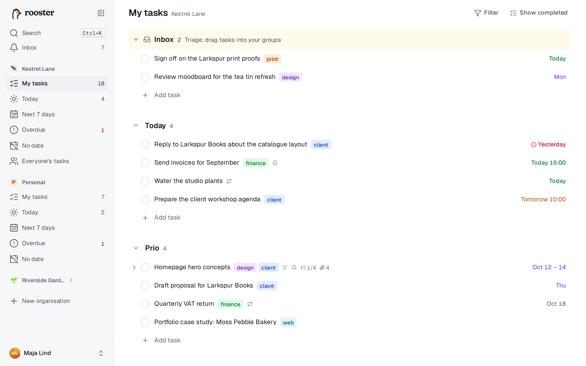
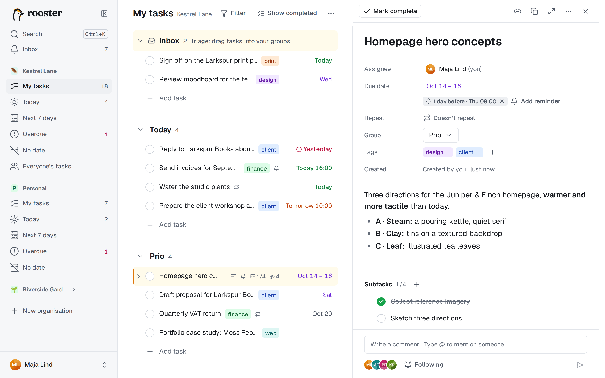

# My tasks

My tasks is your own list in an organisation: the tasks assigned to you, arranged in your own groups and in exactly the order you choose. Nothing is ever sorted for you.

## Groups

Groups are personal. Two people in the same organisation each have their own groups and their own order.

- **Create a group at the cursor:** press **Tab+N** (hold Tab, press N). The new group starts directly below the selected task, and the tasks below it move into the new group.
- **Turn a task into a group:** type a title that ends with a colon, such as `Waiting for:`, and press Enter. A chip asks you to press Enter again to turn the row into a group header.
- **Add a group at the end:** choose **Add group** at the bottom of the list.
- **Rename:** click the group name, or select the header and press F2.
- **Collapse or expand:** click the chevron, or select the header and press ← or →. Alt+click collapses or expands all groups.
- **Reorder:** drag the header, or select it and press Ctrl+↑ / Ctrl+↓.
- **Delete:** open the header's **⋯** menu and choose **Delete group**. An empty group goes at once (with Undo). For a group with tasks you choose to **Move tasks to** another group or **Delete the tasks too**. You always keep at least one group.

### Inbox

The **Inbox** is a special group pinned at the top. It collects tasks that arrive without a group: tasks someone else assigned to you, and tasks added from the command line or an AI agent. It is hidden when it's empty. Drag its tasks into your own groups to triage them. The Inbox can't be renamed, moved or deleted.

## Add and edit tasks

- **Enter** while editing adds a task below; **Shift+Enter** adds one above. While a row is only selected, **N** and **Shift+N** do the same, and **Q** (or Tab+Q) adds a task at the top of the first group.
- **Add task** at the end of each group adds one there.
- **Give a new task a date** while you type its name: click the calendar on the right of the row, or press **Tab+D**. On a phone, tap the calendar or the **Date** button above the keyboard. Pick a date, carry on typing, and press Enter. You can also type the date into the name, such as `fri` ([Dates](./dates-and-repeats.md)).
- Click a title to edit it. Changes are saved when you press Enter or Esc, move to another row or click elsewhere.
- **Paste several lines** into an empty title, and a chip offers to create one task per line. Press Enter to accept, or Esc to paste the text as one line.
- **Backspace in an empty title** removes the row, as long as the task has no description, subtasks, comments or attachments. Otherwise use Tab+Delete.

While you type a title you can add:

| Type | Effect |
|---|---|
| a date, such as `fri` or `12 oct` | sets the due date ([Dates and repeating tasks](./dates-and-repeats.md)) |
| `every mon` | makes the task repeat |
| `#tag` | adds a tag; suggestions appear, and a new name creates the tag |
| `@name` | assigns the task (shared organisations) |
| `!1h` | adds a reminder ([Reminders](./reminders.md)) |

Each recognised part is highlighted. Click a highlight, or press Backspace right after it, to keep it as plain text. Wrap text in backticks (`` `next week` ``) to stop it from being read at all.

## Subtasks

Subtasks are full tasks with their own dates, tags, description and subtasks, up to five levels deep.

- **Tab+S** (or **S** when the row is selected) adds a subtask to the selected task and opens it for typing. Enter in a subtask adds the next one.
- The chevron in front of a parent shows or hides its subtasks in the list; ← and → do the same from the keyboard. rooster remembers what you expanded.
- The row shows progress, such as *2/5*.
- To turn existing tasks into subtasks, select them, open the command palette (Ctrl+K) and choose **Make subtask of…**.
- A subtask assigned to you whose parent isn't yours appears as its own row, with the parent's title in front of it (*Parent ›*).

## The detail pane

The pane shows one task in full: assignee, due date, repeat, reminders, group, tags, description, subtasks, attachments and the activity feed.

- **Open it:** click the row (not the title), press **O** (focus moves into the pane), **Space** (peek: the pane opens and focus stays in the list) or **Tab+Enter** (edit the pane's title).
- While it is open, ↑ and ↓ in the list change which task it shows. A task you add while it is open shows in the pane as soon as you press Enter, so you can go on with its description (click it, or press Tab+R).
- **Description:** a rich editor that stores Markdown. Markdown shortcuts work as you type (`# `, `- `, `[] `, `**bold**`). Select text for a small formatting toolbar. **Ctrl+click** (⌘+click) opens a link; a plain click lets you edit its text. On a phone or tablet, tap a link to see its address: tap the address to open it, or edit or remove the link. Long descriptions fold after about 12 lines behind **Show more**. Tab+R jumps into the description.
- **Toolbar:** **Mark complete**, **Copy link**, **Duplicate**, **Full screen** (Tab+X) and **More actions** (Delete task, Copy task ID, Open in new tab, Move to group).
- Esc returns to the list; Esc again closes the pane. Each task has its own link, so you can bookmark or share it.

## Tags

Tags belong to an organisation and are shared by its members.

- Type `#name` in a title, or press **Tab+T** (or **T** or **#** when the row is selected) to open the tag picker. A new name creates the tag.
- Tags appear as coloured chips after the title.
- **Filter** in the list header shows only tasks with the tags you pick.
- Organisation settings → **Tags** lets you rename, recolour, merge and delete tags.

## Complete tasks

Click the checkbox or press **Ctrl+Enter**. The row is struck through, waits a moment and fades out; the toast's **Undo** (or Ctrl+Z) brings it back to the same place. Completing a parent doesn't complete its open subtasks.

**Show completed** in the list header (or **Shift+H**) shows completed tasks where they were, greyed out. Click a checkbox to reopen one. How long a completed task stays before it fades is a setting: see [Settings](./settings-and-data.md#behaviour).

## The list menu

The **⋯** button in the list header has the list-wide actions: **Add group**, **Show completed**, **Collapse all groups** (**Shift+←**), **Expand all groups** (**Shift+→**), **Export** as JSON or Markdown, and **Print** (**Ctrl+P**, or **⌘P** on a Mac). The printout shows only the list: groups, tasks with their dates, tags and assignees, and subtasks indented. On a phone, the same actions are at the top of the **⋯** menu in the header.

## Move tasks

- **Drag** a row by its handle (it appears on hover), or anywhere on the row except the title, checkbox and date. Drop it between tasks in any group, or on a group header to put it at the top.
- **From the keyboard:**

| Keys | Moves the task |
|---|---|
| Ctrl+↑ / Ctrl+↓ | one place up or down, across group borders |
| Ctrl+Shift+↑ / Ctrl+Shift+↓ | to the end of the previous group / the start of the next one |
| Alt+Shift+↑ / Alt+Shift+↓ | to the top / bottom of its group |
| M or Tab+M | to a group you pick (type to filter, or press 1–9) |

You can also drag with the keyboard alone: Tab to a row's handle, Space to pick it up, the arrow keys to move, Space to drop.

## Select several tasks

Shift+click or Shift+↑/↓ selects a range; Ctrl+click or **X** adds and removes single tasks. **Ctrl+A** selects the group, and again everything. With two or more selected, a bar appears at the bottom: **Complete**, **Date**, **Move to**, **Tag**, **Assign** (shared organisations) and **Delete**. Esc clears the selection.

## Delete and Trash

Press **Delete** (or Backspace) on a selected row, or **Tab+Delete** while editing. Deleted tasks go to the Trash of their organisation, where they stay for 30 days; you can restore them from Settings → Data ([Settings and your data](./settings-and-data.md)).

## Undo and redo

**Ctrl+Z** undoes your last change, and **Ctrl+Shift+Z** (or Ctrl+Y) redoes it. rooster remembers the last 50 changes in this session: creating, renaming, dating, moving, completing, deleting, tagging and changes to groups. Undo works offline too. While you're typing in a field, Ctrl+Z first undoes your typing.

On a Mac, use ⌘ wherever this page says Ctrl. All shortcuts are in [Keyboard shortcuts](./keyboard.md).
