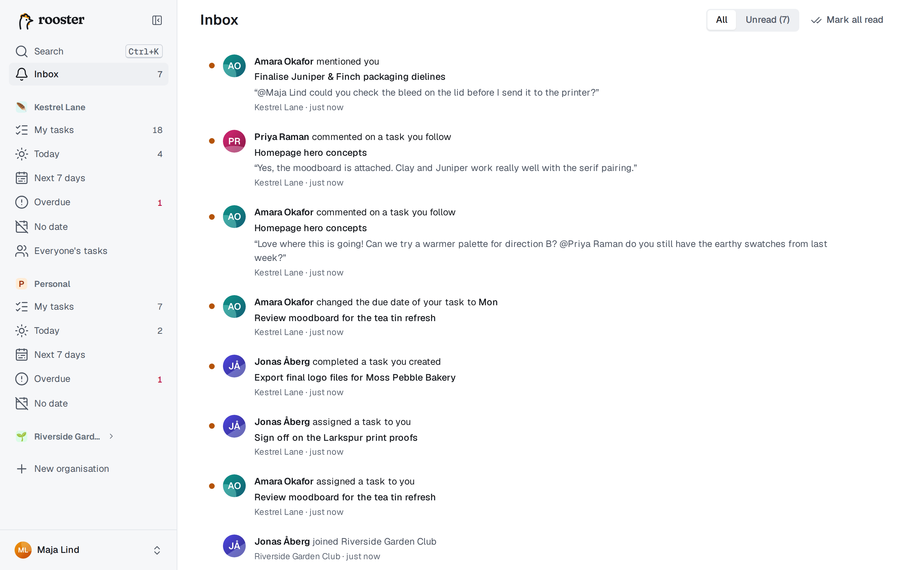
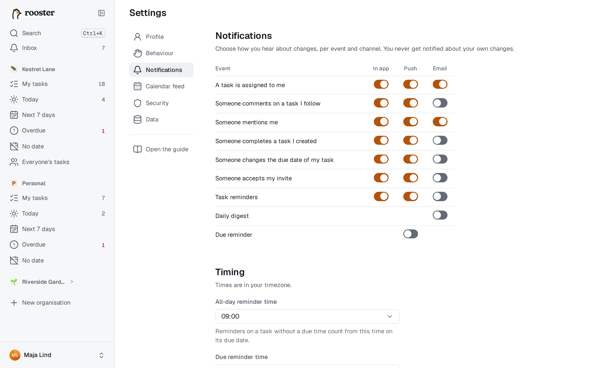

# Notifications

rooster tells you when something happens that concerns you: in the app's **Inbox**, as a **push** notification on your devices, and by **email** if your server sends email. You choose which events reach you on which channel.

You are never notified about your own changes. The one exception is [task reminders](./reminders.md), which you set for yourself.

## The Inbox

The **Inbox** collects notifications from all your organisations. Open it from the sidebar on a computer (or press `G` then `I`), or from the Inbox tab in the bottom bar on a phone. The badge shows how many are unread.

You get a notification when:

| Event | Example |
|---|---|
| A task is assigned to you | "Amara assigned a task to you" |
| Someone comments on a task you follow | with the start of the comment |
| Someone mentions you | in a comment, with `@your name` |
| Someone completes a task you created | |
| Someone changes the due date of your task | with the new date |
| Someone accepts your invite | "Jonas joined Studio" |
| One of your task reminders is due | "Reminder", with the due time |

- Click a notification to open the task. It is marked as read.
- Use the button on each notification to mark it read or unread, or **Mark all read** at the top.
- **Show: All / Unread** filters the list.

Assignments, comments and mentions only happen in shared organisations, so your personal organisation only produces reminders. See [Working together](./collaboration.md) for following tasks.

## Push notifications

Push works per device: turn it on separately on each phone and computer where you want it.

1. On that device, open **Settings → Notifications**.
2. Choose **Turn on push for this device** and allow notifications when the browser asks.
3. Use **Send test** next to the device to check that it arrives.

**Your devices** lists every device with push on and its last delivery; **Remove** turns push off for one. Clicking a push notification opens the task.

- **iPhone and iPad:** push works only in the installed app. Add rooster to your Home Screen first (see [Phone and offline](./phone-and-offline.md#install-the-app)), then turn push on from there.
- **Blocked?** If you once refused notifications, allow them for rooster in the browser's site settings (on iOS: the Settings app → Notifications), then reload.
- Signing out turns push off for that device.

## Email

Email is available only when your server administrator has set it up. Without it, the email column doesn't appear.

- **Notification emails** go out **Immediately**, or collected into one email **Every 15 minutes** (the default). Change this under **Timing**.
- **Daily digest:** one email a day with what's due today, what's overdue and what's new in your Inbox.
- Every email has an unsubscribe link for its kind of email. It asks you to confirm before it unsubscribes, and you can turn the emails back on in Settings → Notifications.

## Choose what you get

**Settings → Notifications** has a grid of events by channel: **In app**, **Push** and **Email**. Tick what you want; changes are saved at once.

The defaults are:

| | In app | Push | Email |
|---|---|---|---|
| Assignments and mentions | on | on | on |
| Comments, completions, due date changes, accepted invites | on | on | off |
| Task reminders | on | on | off |
| Daily digest (email only) | | | off |
| Due reminder (push only) | | off | |

Two rows are extras, not events:

- **Due reminder** (push): every morning, a push that lists the tasks due that day.
- **Daily digest** (email): the summary email described above.

Their times are under **Timing**, in your own time zone:

| Setting | Default |
|---|---|
| Due reminder time | 08:00 |
| Daily digest time | 07:00 |
| All-day reminder time | 09:00 |

**All-day reminder time** is when reminders fire for tasks that have a due date but no time; see [Reminders](./reminders.md).
