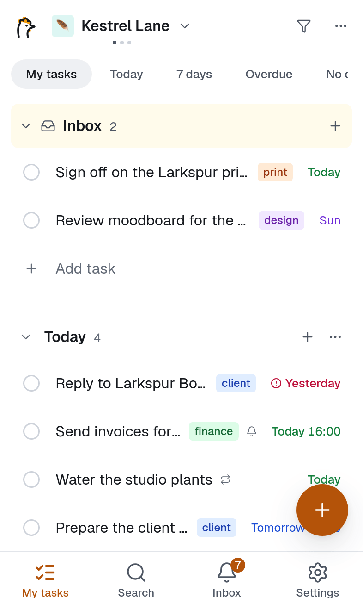
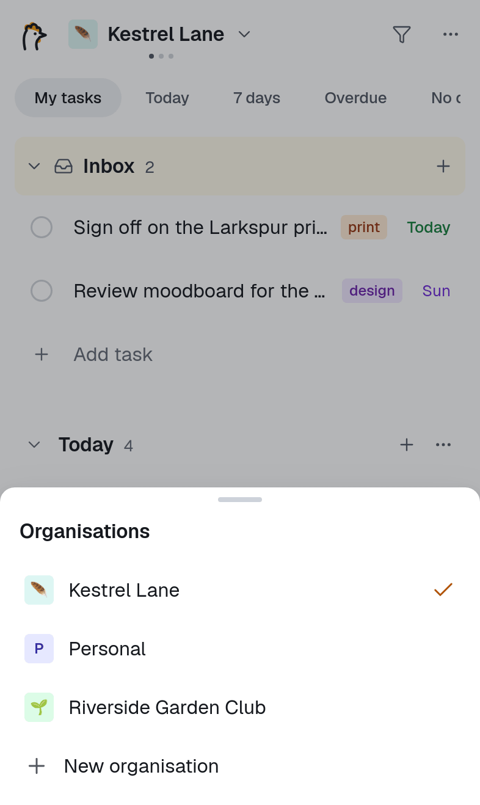
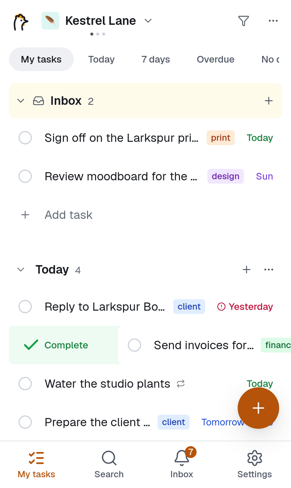
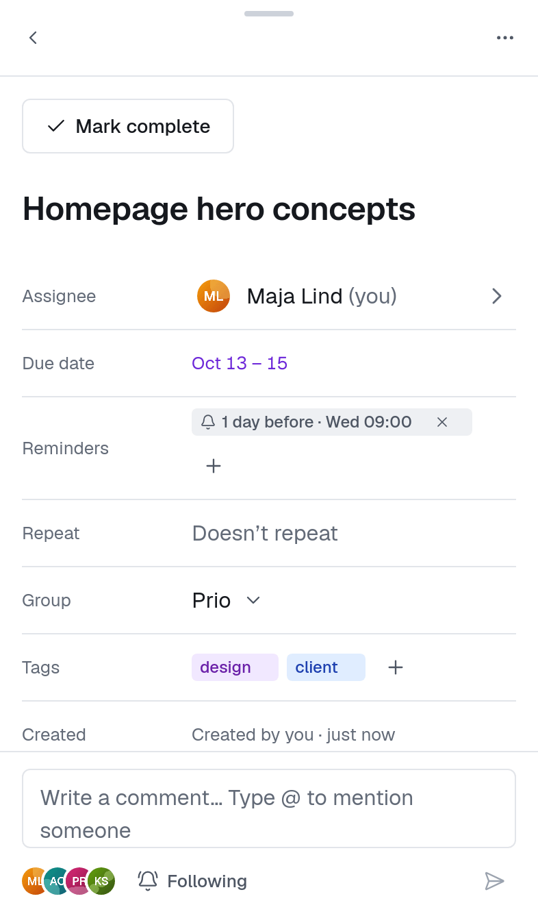

# Phone and offline

rooster works in any modern browser and installs as an app on phones, tablets and computers. Once you have used it, it keeps working without a connection and syncs your changes when you are back online.

## Install the app

- **Android (Chrome):** use **Install** when rooster offers it, or the browser menu's *Install app* / *Add to Home Screen*.
- **iPhone and iPad (Safari):** tap **Share** in Safari's toolbar, choose **Add to Home Screen**, then **Add**.
- **Computer (Chrome, Edge):** use the install icon in the address bar, or **Settings → Profile → Install app**.

**Settings → Profile → Install app** also explains the steps for your device.

On iPhone and iPad the installed app keeps its own storage, so you sign in once more after installing. You need the installed app there for [push notifications](./notifications.md#push-notifications) too.

## The phone layout

- **Header:** the organisation switcher on the left (tap the name to switch, or to create a **New organisation**), and on the right the sync status and a **More** menu. To switch faster, swipe the name left or right for the next or previous organisation (the dots under it show where you are), or hold the name, slide your finger to an organisation and let go. You stay on the same view, so Today stays Today.
- **View switcher:** My tasks · Today · 7 days · Overdue · No date · Everyone. It stays at the top while you scroll.
- **Bottom bar:** My tasks · Search · Inbox · Settings.
- **Add button (+):** adds a task at the top of the first group, or of the current view. The keyboard opens with a bar above it: **Date**, **Group**, **Add tag** and **Next**. **Next** saves the task and starts another one; tap outside to finish. Dates typed in the title work as on a computer; see [Dates and repeating tasks](./dates-and-repeats.md).

## Gestures

| Gesture | What it does |
|---|---|
| Tap a task | Opens it full screen |
| Tap the circle | Completes the task, with **Undo** in the message at the bottom |
| Swipe right | Complete (by default) |
| Swipe left | Set date (by default): Today, Tomorrow, Weekend, Next week, Pick date…, No date |
| Long-press, then drag | Moves the task; dragging near the top or bottom scrolls |
| Long-press and let go | Selection mode: tap tasks to select them, then act on all of them from the bar at the bottom. **Done selecting** ends it. |
| Pull down at the top | Refreshes the list and sends waiting changes |

Choose what each swipe does in **Settings → Behaviour**: Complete, Set date, Move to group, Delete, or Nothing.

## The task sheet

Tapping a task opens it as a full-screen sheet with everything the desktop pane has: dates, repeat and reminders, tags, description, subtasks, attachments and comments. Fields open sheets from the bottom instead of popovers. Close it with the back button at the top, by swiping down from the top, or with your phone's back gesture.

## Tablets

On a tablet the sidebar is a narrow rail that opens over the content, and a task opens in a pane that slides in from the right. Everything else works as on a computer, keyboard included.

## Offline

Once rooster has loaded your lists, you can keep using it without a connection:

- **What you can read:** your lists in every organisation, the smart views, groups and tags, and tasks you have opened recently. Search also works, over the tasks on your device.
- **What you can change:** tasks, groups, tags, subtasks, comments and follows. Each change is saved on the device and sent when the connection is back, automatically.
- **What needs a connection:** the Inbox, settings, attachments, export and the Trash, and signing in or out.

The sync status in the header shows what's happening:

| Status | Meaning |
|---|---|
| (nothing) | Everything is saved on the server. |
| **Offline** | No connection, nothing waiting. |
| **Offline · 3 pending** | No connection; 3 changes will be sent later. |
| **Syncing…** | The connection is back and changes are being sent. |
| **Sync problem · Retry** | The server didn't accept changes after several attempts. Tap **Retry**. |

If two people change the same field, the later change wins. If a waiting change can no longer be applied, for example because someone deleted the task meanwhile, rooster undoes it on your device and tells you why ("Couldn't save … – it was deleted").

Don't sign out while changes are still waiting: signing out clears the data stored on the device, including changes that haven't been sent.

## Updates

When a new version of rooster has been installed on the server, you see **New version available · Reload**, and an **Update** chip stays in the header until you reload. rooster never reloads on its own while you are typing or while changes are waiting; it reloads as soon as they are saved.
