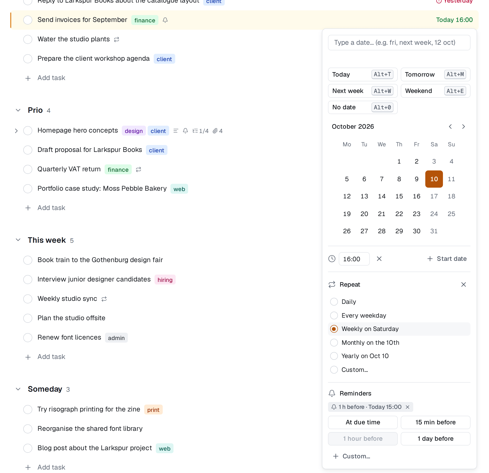

# Reminders

A reminder tells you about a task at the moment you choose. Reminders are personal: only you see the reminders you set, and only you are reminded. You can set them on any task you can see, not only your own.

## Two kinds

- **Before the due date:** *at due time*, *15 min before*, *1 hour before*, *1 day before*, or any other offset (up to four weeks). These follow the task: move the due date and the reminder moves with it.
- **At a fixed time:** a date and time you pick, such as *Friday 14:00*. This is the only kind a task without a due date can have.

A task can have up to five of your reminders.

## Set a reminder

**While typing a title**, add a token at the end:

| Token | Reminds you |
|---|---|
| `!15m` | 15 minutes before the due moment |
| `!1h` | 1 hour before |
| `!1d` | 1 day before |
| `!due` | at the due moment |

Any number works (`!90m`, `!2h`, `!3d`). The token is highlighted like a date and removed when you press Enter. It needs a due date, so combine it with one: `Send the quote fri 14:00 !1h`. A plain exclamation mark is just text, so *Ship it!* stays as it is.

**In the date picker,** choose **Reminder** (Alt+R). The section lists the task's reminders as chips (for example *1 h before · Fri 13:00*) and offers presets: **At due time** (tasks with a time), **15 min before**, **1 hour before**, **1 day before**, **On the day at 09:00** (tasks without a time) and **Custom…**, where you type an offset like `2h` or `3d`, or a moment like `fri 14:00`. The picker stays open while you add reminders; Esc or a click outside closes it.

**In the detail pane,** the **Reminders** line under the due date shows when each reminder will go off, with **Add reminder**.

To remove a reminder, remove its chip.

A row with a pending reminder shows a small **bell**; hover it to see when the next one is due.

## Tasks without a time

For a task with a date but no time, "before" counts from a time of day you choose: the **All-day reminder time** in Settings → Notifications (09:00 unless you change it). *1 day before* on a task due Friday then reminds you on Thursday at 09:00.

## When the due date goes away

If you remove a task's due date, its "before" reminders are **paused**: they don't go off, and their chips are muted with *needs a due date*. Set a date again and they come back. Reminders at a fixed time are not affected.

## Where reminders arrive

A reminder goes off once and arrives as a notification: in your [inbox](./collaboration.md#the-inbox), as a push notification on the devices where you've turned push on, and by email if you choose. The **Task reminders** row in Settings → Notifications decides which; by default in-app and push are on and email is off. See [Notifications](./notifications.md).

- Completed and deleted tasks never remind you.
- Unlike other notifications, you get reminders about changes you made yourself; that's the point.
- If the server was down when a reminder was due, it is sent when it's back, up to 24 hours late, and marked *sent late*.

## Repeating tasks

When you complete a repeating task, the next instance keeps your "before" reminders, adjusted to its new date. Reminders at a fixed time are not copied. See [Dates and repeating tasks](./dates-and-repeats.md#repeating-tasks).
