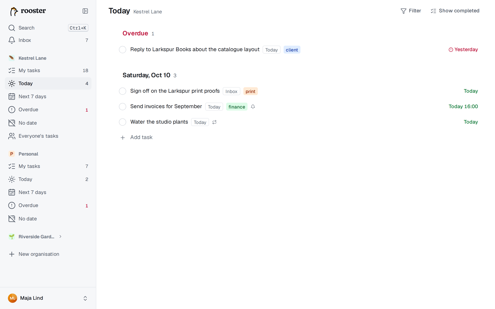
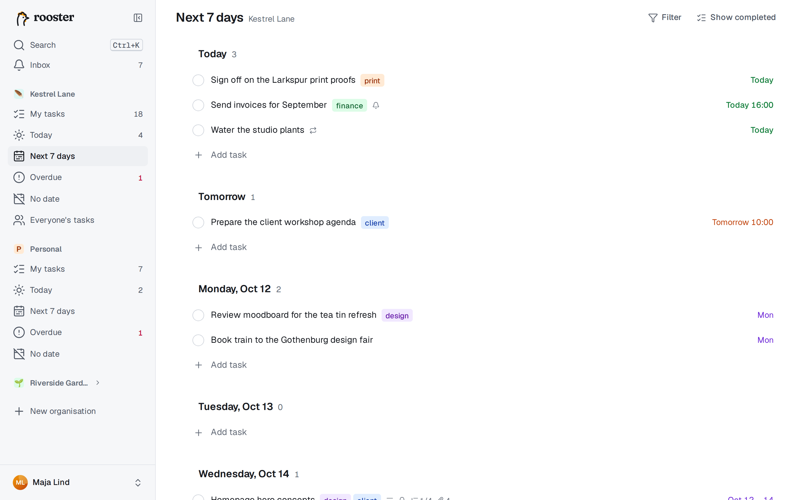
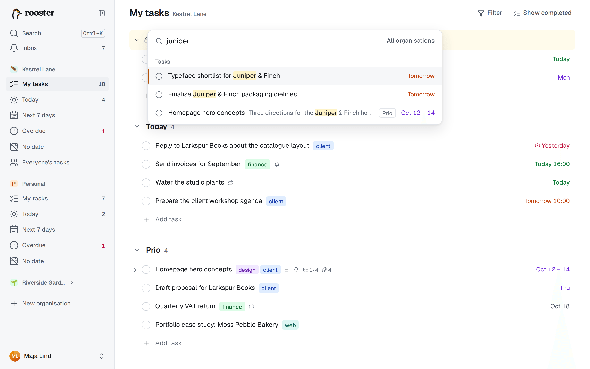

# Views and search

Besides My tasks, each organisation has four **smart views** that sort your tasks by date, and the command palette finds anything in a few keystrokes.

## Smart views

Smart views show your tasks (the ones in My tasks, including subtasks assigned to you) grouped by date. They never change your groups or your order in My tasks. Rows work as usual: complete, re-date, tag or open them. Dragging is off in these views, because they are sorted; to change a date, press **D**.

| View | Shows | Go there |
|---|---|---|
| **Today** | an *Overdue* section, then everything due today (headed with today's date) | G then T |
| **Next 7 days** | one section per day: Today, Tomorrow, then each weekday | G then W |
| **Overdue** | everything past its due date, oldest first | G then O |
| **No date** | tasks without a due date, in My tasks order | G then N |

Each row shows its group as a small chip. The sidebar counts open tasks for Today and Overdue (the Overdue count is red), so you see at a glance whether something needs attention. Completed tasks are hidden unless you turn on **Show completed**.

**Adding tasks in a view.** A task added in Today is due today, in a day of Next 7 days on that day, and in No date without a date. It goes to your Inbox; to put it in a group, end the title with `>Group`, for example `Order toner >Prio`.

## Everyone's tasks

Shared organisations also have **Everyone's tasks**, all open tasks grouped by person (G then E). See [Working together](./collaboration.md#everyones-tasks).

## The command palette

Press **Ctrl+K** (⌘K on a Mac), click **Search** in the sidebar, or press **/** when no text field has focus.

- With an empty box, it shows your **Recent** tasks and the **Actions** you can take, including those for the selected task.
- Type to search tasks. Results show the title, the group or organisation, and the due date. Enter opens the task in its list.
- Start with `>` to search only actions: go to a view or organisation, create a task, show completed tasks, open Trash, export, and every task action, such as **Make subtask of…**. Shortcuts are shown next to them.
- Search covers the current organisation. Turn on **All organisations** to search them all.

## Search syntax

Search looks in titles, descriptions and comments. Each word matches the start of words (`dent` finds *dentist*), ignoring case and accents. Use double quotes to keep a phrase together: `"quarterly report"`.

| Filter | Finds |
|---|---|
| `#tag` | tasks with that tag (several `#` filters must all match) |
| `@name` | tasks assigned to that person (name or email); `@me` for yours |
| `due:today` | due today or earlier, like the Today view |
| `due:week` | due within the next 7 days |
| `due:overdue` | past their due date |
| `due:none` | without a due date |
| `is:open` / `is:done` | only open / only completed tasks |

Without `is:`, completed tasks are included, after the open ones. Swedish filter words work too: `due:idag`, `due:försenade`, `due:vecka`, `due:utan`, `is:öppen`, `is:klar`.

Example: `invoice #finance due:week` finds tasks mentioning *invoice*, tagged *finance*, due within a week.

## Offline

Without a connection the palette searches the tasks stored on your device and says *Offline — showing cached tasks*. See [Phone and offline](./phone-and-offline.md).
