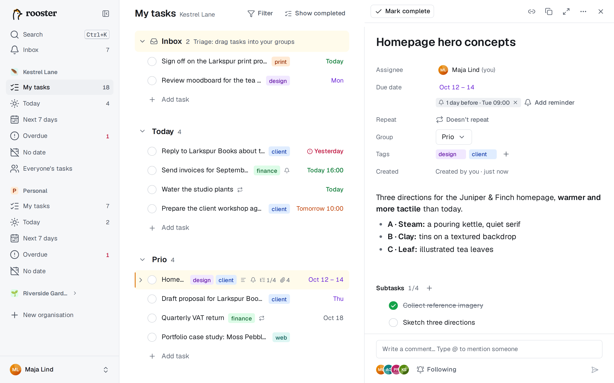
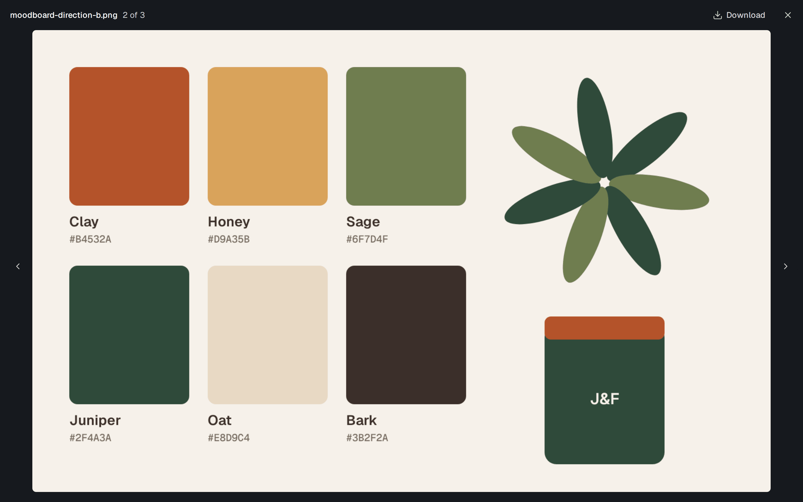

# Bilagor

Bifoga skärmdumpar, dokument och andra filer till vilken uppgift som helst. De visas under **Bilagor** i uppgiftspanelen, nedanför deluppgifterna.

## Lägga till filer

Öppna uppgiften (klicka på raden eller tryck `O`) och gör något av följande:

- **Släpp** filer var som helst på panelen. Medan du drar visas ”Släpp för att bifoga”.
- **Klistra in** en bild, till exempel en skärmdump du just tagit, när panelen har fokus. Den sparas som ”Inklistrad bild” med datum och tid.
- **Välj** filer med **Bifoga filer**, eller med **välj filer** om uppgiften inte har några bilagor än.

Varje uppladdning visar hur långt den har kommit, och du kan avbryta den. Om något går fel står det varför, med **Försök igen** där det hjälper.

På mobilen öppnar du uppgiften och väljer bilder eller filer med **Bifoga filer**.

## Bilder och andra filer

- **Bilder** får en miniatyr. Klicka på en för att öppna den i bildvisaren: `←` och `→` går till föregående och nästa bild, `Esc` stänger, och **Ladda ner** sparar originalet.
- **Andra filer** visas med storlek, vem som lade till dem och när. Klicka på en fil för att ladda ner den.

rooster kontrollerar vad en fil faktiskt är. En fil vars innehåll inte stämmer med namnet, till exempel ett program som döpts om till `.pdf`, tas inte emot.

## Ta bort en fil

Använd papperskorgsikonen bredvid filen och bekräfta med **Ta bort**. Det går inte att ångra. Du kan ta bort filer som du själv har lagt till, och alla filer på uppgifter där du är ansvarig.

## Gränser

- En fil får vara högst **25 MB**, om inte din administratör har ändrat gränsen. En för stor fil stoppas innan den skickas, och meddelandet anger gränsen.
- En uppgift kan ha högst **100** bilagor.
- Din administratör kan också ha satt en **lagringskvot**: hur mycket filer du sammanlagt får ladda upp. Filer på uppgifter i papperskorgen räknas tills papperskorgen töms (efter 30 dagar, eller när någon tar bort dem permanent). En uppladdning som skulle gå över kvoten stoppas, och ingenting sparas.

## Offline

Bilagor kräver en anslutning. När du är offline står det i avsnittet, och du kan lägga till eller ta bort filer igen när du är online.

## Vem ser bilagorna

Alla som ser uppgiften kan se och ladda ner dess filer. Bilagor kopieras inte när du duplicerar en uppgift, eller när en återkommande uppgift skapar nästa förekomst.

Din profilbild ställer du in på ett annat ställe: se [Inställningar och dina data](./settings-and-data.md#profil).
