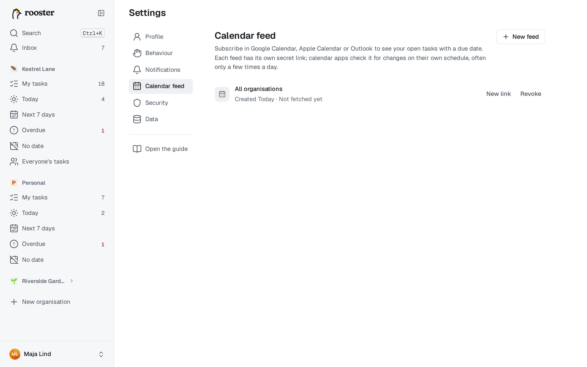

# Kalenderflöden

Ett kalenderflöde lägger in dina förfallodatum i den kalenderapp du redan använder: Google Kalender, Apple Kalender, Outlook eller någon annan app som kan prenumerera på en kalender via en adress. Flödet går bara att läsa, så uppgifterna ändrar du fortfarande i rooster.

## Skapa ett flöde

1. Öppna **Inställningar → Kalenderflöde** och välj **Nytt flöde**.
2. Under **Uppgifter från** väljer du en organisation, eller **Alla organisationer**.
3. Välj **Skapa flöde**.
4. Kopiera länken med **Kopiera länk**, eller använd **Prenumerera** för att lämna den direkt till kalenderappen på datorn eller telefonen.

Länken visas bara den här gången. Om du tappar bort den skapar du en ny (se nedan). Du kan ha upp till 10 flöden, till exempel ett per organisation.

## Prenumerera i kalenderappen

- **Google Kalender** (på webben): välj **+** vid *Andra kalendrar* → **Från webbadress**, klistra in länken och välj **Lägg till kalender**. Flödet syns sedan också i Google Kalender på telefonen.
- **Apple Kalender** på Mac: **Arkiv → Ny kalenderprenumeration**, klistra in länken. På iPhone och iPad öppnar **Prenumerera** Kalender direkt; annars går du till *Inställningar → Appar → Kalender → Kalenderkonton → Lägg till konto → Annat → Lägg till prenumererad kalender*.
- **Outlook:** **Lägg till kalender → Prenumerera från webben**, klistra in länken.

Menyernas exakta namn skiljer sig mellan olika versioner av apparna.

## Vad flödet innehåller

- Dina **öppna uppgifter där du är ansvarig och som har ett förfallodatum** (deluppgifter också), från 90 dagar tillbaka och framåt.
- En uppgift med bara datum blir en **heldagshändelse**. En uppgift med klockslag blir en **händelse på 30 minuter** vid den tiden.
- Varje händelse börjar med ☐, och beskrivningen länkar tillbaka till uppgiften i rooster.
- Klara och borttagna uppgifter försvinner ur flödet.

## Hur snabbt ändringar syns

rooster uppdaterar ett flöde högst var 15:e minut. Kalenderapparna hämtar ändringar när de själva vill, ofta bara några gånger om dagen; Google Kalender kan ta upp till ett dygn på sig. En ändring du gör i rooster tar alltså en stund innan den syns i kalendern.

## Håll länken hemlig

Alla som har länken kan se rubriker och förfallodatum för uppgifterna i den, utan att logga in. Behandla den som ett lösenord.

- **Ny länk** ersätter länken: den gamla slutar fungera direkt, och kalendrar som prenumererar på den behöver den nya.
- **Återkalla** stänger av flödet för gott. Kalendrar som prenumererar på det slutar att uppdateras.

Vid varje flöde står när en kalenderapp senast hämtade det, så du ser om det används.
