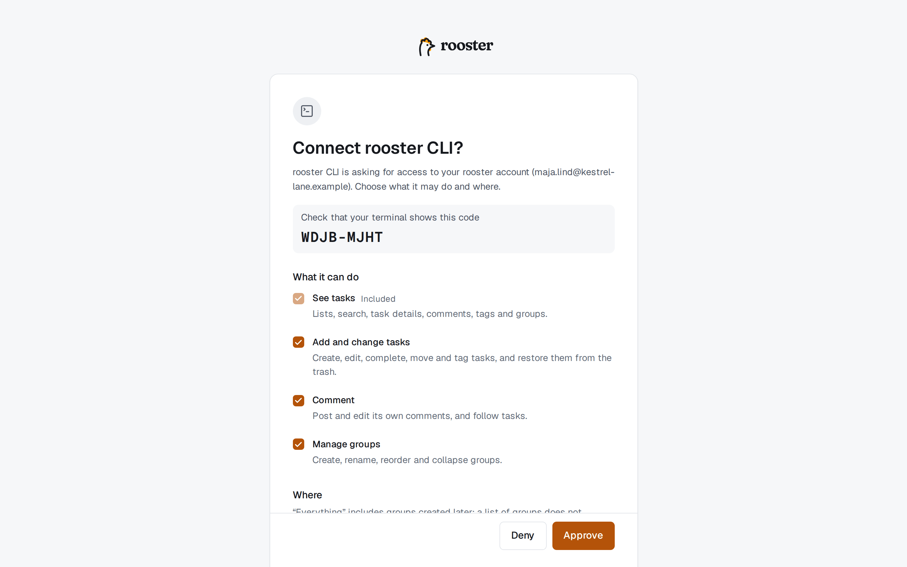
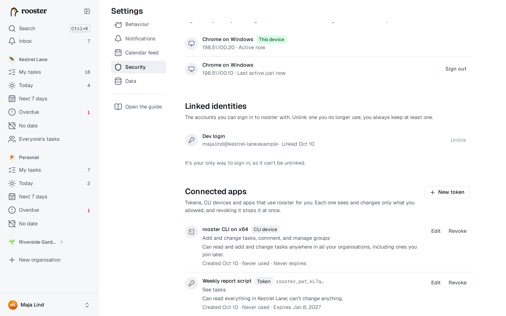

# Terminal och AI-agenter

Kommandoradsverktyget `rooster` låter dig arbeta med dina uppgifter från en terminal och i skript. Det har också en terminalapp i helskärm, och det kopplar AI-agenter som Claude till rooster via MCP. Du bestämmer exakt vad var och en får se och ändra.

## Installera kommandoradsverktyget

- **Fristående programfil:** ladda ner `rooster-<version>-<plattform>` för Linux (x64, arm64), macOS (Apple-chip, Intel) eller Windows (x64) från projektets releasesida, gör den körbar (`chmod +x`) och lägg den i din `PATH` som `rooster`. Bredvid varje fil finns en kontrollsumma (`.sha256`).

Kontrollera installationen med `rooster --version`.

## Logga in

```sh
rooster login --server https://rooster.example.com
```

1. Verktyget visar en kod och öppnar roosters godkännandesida i webbläsaren. På en dator utan webbläsare lägger du till `--no-browser` och öppnar den utskrivna adressen på valfri enhet, till exempel mobilen.
2. Kontrollera att koden stämmer och välj sedan vad kommandoraden får göra och var: vilka organisationer, och vilka grupper den får läsa och ändra. Se [Vad en anslutning får göra](#vad-en-anslutning-får-göra).
3. Välj **Godkänn**. Terminalen fortsätter av sig själv.



Inloggningen sparas i systemets nyckelring, eller i en fil som bara du kan läsa där det inte finns någon nyckelring. `rooster whoami` visar vem du är inloggad som och vad inloggningen får göra, och `rooster logout` loggar ut och återkallar inloggningen.

- **Flera servrar eller konton:** lägg till `--profile jobb` på valfritt kommando. Inställningarna finns i `~/.config/rooster/config.toml`.
- **I skript och CI:** skicka en personlig åtkomsttoken till `rooster login --with-token` via standard in, eller sätt `ROOSTER_TOKEN`. `ROOSTER_SERVER`, `ROOSTER_ORG` och `ROOSTER_PROFILE` går också före inställningarna, och `NO_COLOR` stänger av färgerna.

## Vanliga kommandon

```sh
rooster today                     # förfaller idag eller är försenat; även: rooster week, rooster ls overdue
rooster ls                        # Mina uppgifter, per grupp
rooster add "Boka tandläkare fre #hälsa >Idag"
rooster add "Skicka faktura imorgon 14:00 !1h"         # med en påminnelse en timme innan
rooster add "Vattna blommorna varje måndag"            # en återkommande uppgift
rooster add "Planera konferensen" --due "nästa vecka" --repeat "varje månad"
rooster done 42 57                # markera uppgift 42 och 57 som klara
rooster mv 42 --group Prio --bottom
rooster show 42                   # beskrivning, deluppgifter, taggar, påminnelser, bilagor, kommentarer
rooster edit 42 --editor          # skriv beskrivningen i $EDITOR
rooster tag 42 +brådskande -senare
rooster sub 42 "Ring banken"      # en deluppgift
rooster comment 42 "Har skickat utkastet"
rooster search "faktura #ekonomi"
rooster open 42                   # öppna uppgiften i webbläsaren
```

- **Sätt alltid rubriken inom citattecken.** Annars tolkar skalet `#` som en kommentar och `>` som en omdirigering.
- Rubriker förstår samma [datum och upprepningar](./dates-and-repeats.md), `#taggar`, `>Grupp`, `@person` och [`!1h`-påminnelser](./reminders.md) som appen, på det språk du har valt i din profil. Med `--no-parse` blir rubriken exakt som du skrev den.
- `rooster rm 42` flyttar en uppgift till papperskorgen, och `rooster restore 42` tar tillbaka den. För en återkommande uppgift tar `--occurrence` bara bort just den förekomsten och skapar nästa.
- `rooster group …` och `rooster tag ls|add|rm` hanterar grupper och taggar. `rooster org ls` och `rooster org use <slug>` listar organisationer och väljer standardorganisation, och `--org <slug>` fungerar på alla kommandon.
- `rooster completion bash` (eller `zsh`, `fish`, `powershell`) skriver ut kompletteringar för skalet, också för dina grupp- och taggnamn.
- `rooster <kommando> --help` visar alla alternativ.

### Hänvisa till uppgifter

| Du skriver | Betyder |
|---|---|
| `42` | Uppgift 42 i den aktuella organisationen (numret som står i alla listor) |
| `personal#42` | Uppgift 42 i en annan organisation |
| `0192f3a0` | Ett uppgifts-id, eller minst de 8 första tecknen av det |
| `@last` | Uppgiften du senast lade till eller visade |
| `-` | Läs hänvisningarna från standard in, en per rad |

### I skript

Med `--json` får du strukturerad utdata, och med `--quiet` skrivs bara hänvisningarna ut:

```sh
rooster ls overdue --json | jq -r '.[].seq' | rooster done -
```

Slutkoden talar om för skriptet vad som hände: `0` gick bra, `2` felaktigt kommando, `3` inte inloggad eller saknar behörighet, `4` hittades inte, `5` konflikt eller ogiltigt värde, `6` problem med nätverket eller servern.

## Terminalappen

Kör `rooster` utan argument i en terminal för att öppna en version av rooster i helskärm som styrs helt med tangentbordet. Den har samma vyer och organisationer och uppdateras direkt när något ändras på annat håll.

| Tangenter | Gör |
|---|---|
| `j` `k` eller `↓` `↑` | Flytta mellan raderna |
| `Enter` eller `i` | Redigera rubriken |
| `n` / `N` | Ny uppgift nedanför / ovanför |
| `x` | Markera som klar eller öppna igen |
| `d` | Datum, upprepning eller påminnelse: `fre 14:00`, `varje måndag`, `!1h` eller `none` |
| `t` · `m` · `s` | Taggar · flytta till en grupp · lägg till en deluppgift |
| `o` / `e` | Öppna detaljerna / redigera beskrivningen i `$EDITOR` |
| `J` `K` · `]` `[` | Flytta uppgiften nedåt, uppåt · till nästa eller föregående grupp |
| `u` / `Ctrl+R` | Ångra / gör om |
| `/` | Sök |
| `g` och sedan `m` `t` `w` `o` `n` `e` | Mina uppgifter, Idag, Kommande 7 dagar, Försenade, Utan datum, Allas uppgifter |
| `1`–`9` | Byt organisation |
| `?` | Alla tangenter, och hur de skiljer sig från webben |
| `q` | Avsluta |

Terminalappen kräver en anslutning. Utan anslutning misslyckas ändringar, och `r` försöker igen.

## AI-agenter (MCP)

rooster talar MCP, protokollet som AI-assistenter använder för att arbeta med andra verktyg. En ansluten agent kan planera dagen tillsammans med dig, lägga till och slutföra uppgifter, flytta dem mellan grupper, kommentera och läsa din inkorg, inom de gränser du sätter.

### På distans: lägg till roosters adress

I en agent eller app som stöder MCP-servrar på distans lägger du till:

```
https://<din rooster>/mcp
```

Resten hittar agenten själv. Webbläsaren öppnar sedan roosters godkännandesida, som visar vem som frågar och vart du skickas tillbaka. Välj vad agenten får göra (se nedan) och sedan **Tillåt**. Om agenten senare behöver mer, till exempel för att skriva kommentarer, frågar den igen, och de nya behörigheterna är märkta **Ny**.

### Lokalt: `rooster mcp setup`

För agenter som körs på din dator, som Claude Code, Claude Desktop eller Cursor:

```sh
rooster mcp setup --client claude-desktop   # eller cursor; claude-code skriver ut kommandot att köra
rooster mcp setup                            # skriver ut konfigurationen så att du kan klistra in den
```

Det skapar en separat inloggning för agenten (profilen `agent`), som du godkänner på samma sida, så att agenten aldrig använder din egen, bredare inloggning. Lägg bara till `--allow-delete` om agenten ska kunna ta bort uppgifter. Starta om agentappen efteråt.

### Lär agenten att använda rooster

`rooster skill install` installerar roosters skill, som förklarar grupper, vyer och goda vanor för agenten (`--target agents` för agenter som läser `.agents/`, `--project` för bara det aktuella projektet). Varje rooster-server publicerar den också, så en agent på distans hittar den själv.

### Säkerhet

- Agenter behandlar rubriker, beskrivningar och kommentarer som data. De följer inte instruktioner som står i dem.
- En agent kan bara ta bort uppgifter om du har kryssat i **Tillåt att uppgifter tas bort**, och borttagna uppgifter hamnar i papperskorgen, där du kan återställa dem i 30 dagar.
- Allt en agent ändrar syns i uppgiftens aktivitet, så du ser vad den har gjort.

## Vad en anslutning får göra

Samma godkännandesida används för kommandoraden, AI-agenter och personliga åtkomsttoken.

- **Vad den får göra:** Se uppgifter · Lägga till och ändra uppgifter · Kommentera · Tilldela andra · Hantera grupper · Läsa aviseringar, och Ta bort bara med **Tillåt att uppgifter tas bort**.
- **Var:** alla organisationer, eller de du väljer. Per organisation får den läsa **Allt** eller **Bara dessa grupper**, och ändra **Ingenting**, **Allt** eller **Bara dessa grupper**. ”Allt” omfattar grupper som skapas senare, men en lista med grupper gör det inte.
- **Upphör:** om 7, 30 eller 90 dagar, om 1 år, aldrig, eller för appar **Bara den här sessionen** (den upphör efter ett dygn utan användning).

Något som anslutningen inte får göra stoppas, och agenten uppmanas att be dig utöka åtkomsten.

## Personliga åtkomsttoken

Med en token kan ett skript använda rooster utan att du loggar in interaktivt. Skapa en under **Inställningar → Säkerhet → Anslutna appar → Ny token**, eller från en inloggad terminal:

```sh
rooster token create backup --scope tasks:read --expires 30d
```

Token visas en enda gång. Använd den som `Authorization: Bearer <token>`, eller med `rooster login --with-token`.

## Se och återkalla åtkomst

**Inställningar → Säkerhet → Anslutna appar** listar alla token, kommandoradsinloggningar och appar som är anslutna till ditt konto, med vad de får göra och när de senast användes. **Redigera** begränsar en anslutning, och **Återkalla** stoppar den direkt. Från en terminal: `rooster apps ls` och `rooster apps revoke <id>`.


