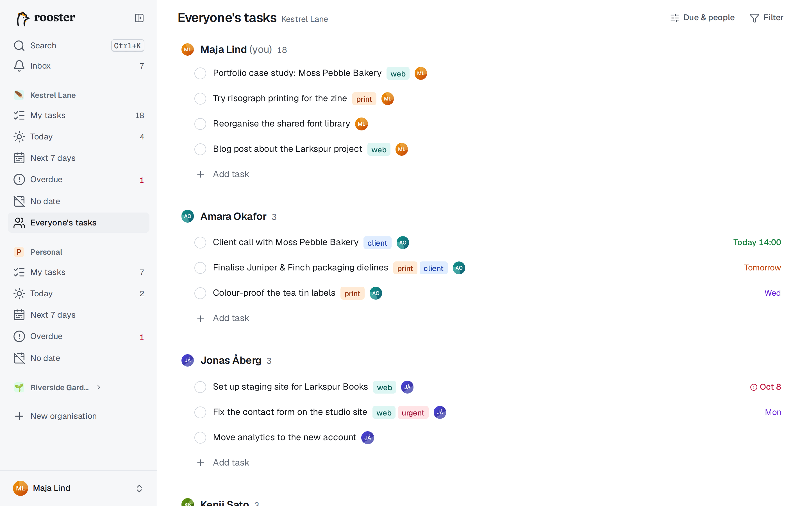
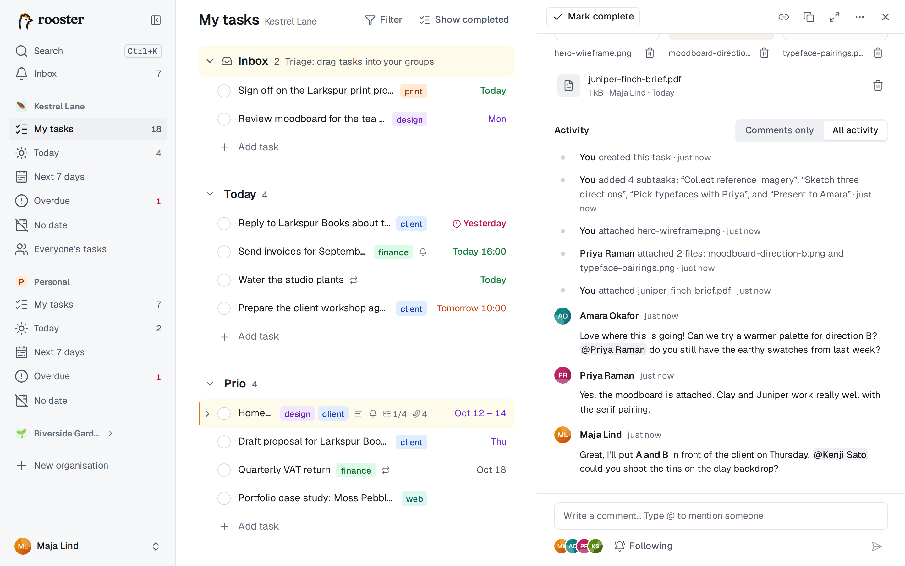
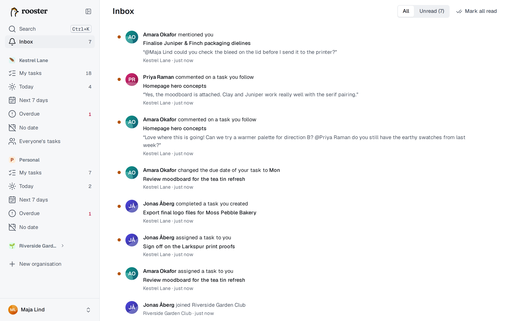

# Samarbete

I en delad organisation ser medlemmarna alla uppgifter, tilldelar varandra uppgifter, kommenterar och följer med i vad som händer. Din organisation Personligt har inget av detta: den är bara din.

## Medlemmar och roller

Det finns två roller:

- **Ägare** ändrar organisationens namn, ikon och färg, bjuder in, ändrar roller, tar bort medlemmar och kan ta bort organisationen. Varje organisation har alltid minst en ägare.
- **Medlemmar** ser och arbetar med alla uppgifter i organisationen.

Alla har sina egna grupper och sina egna Mina uppgifter; ingen annan kan ändra ordningen i dina. Medlemmar och roller finns i **Organisationsinställningar** (organisationens **⋯**-meny i sidofältet). En medlem kan lämna organisationen under **Farozon**. När någon lämnar eller tas bort blir personens uppgifter där utan ansvarig.

## Bjud in personer

1. Öppna organisationens **⋯**-meny och välj **Bjud in personer**.
2. Välj **Via e-post** för att bjuda in en adress, eller **Inbjudningslänk** för att få en länk. En länk kan användas **En gång** eller **Flera gånger** och går ut efter det antal dagar du väljer.
3. Välj roll och skapa inbjudan. Om servern skickar e-post får personen inbjudan med posten; du kan alltid kopiera länken och skicka den själv.

Öppna inbjudningar listas nedanför, där du kan återkalla dem. När någon går med får du en avisering.

## Tilldela uppgifter

En uppgift har högst en ansvarig, och den visas i **den personens** Mina uppgifter.

- Markera en uppgift och tryck på **A** (eller **Tab+A** medan du redigerar) och välj en person.
- Skriv `@namn` i namnet när du skapar en uppgift: `Gör ett utkast till affischen @mei`.
- Använd raden **Ansvarig** i detaljpanelen.
- Markera flera uppgifter och välj **Tilldela** i fältet längst ned.

När du tilldelar någon annan en uppgift försvinner den ur din lista och hamnar överst i **personens inkorg**; meddelandet erbjuder Ångra. Du kan också ta bort den ansvariga. Uppgiften syns då bara under *Ingen ansvarig* i Allas uppgifter (och under sin överordnade uppgift om den är en deluppgift). Deluppgifter med en annan ansvarig visar personens avatar på raden.

## Allas uppgifter

**Allas uppgifter** (G, sedan E) visar alla öppna uppgifter i organisationen: ett avsnitt per person, du först, sedan de andra i bokstavsordning och sist **Ingen ansvarig**. Varje avsnitt är sorterat efter förfallodatum.

- **Filtrera** på tagg, och med **Datum och personer** på förfallodatum (alla datum, försenade, kommande 7 dagar, utan datum) och person.
- **Lägg till uppgift** under en person skapar en uppgift åt personen, i hens inkorg.
- **Dra** en uppgift till en annan persons avsnitt för att byta ansvarig. Det är det enda du kan dra här.

## Kommentarer och omnämnanden

Längst ned i detaljpanelen finns aktivitetsflödet och en kommentarsruta.

- Skriv en kommentar och skicka den med **Ctrl+Enter** (eller Tab+Enter). **C** eller **Tab+C** hoppar till kommentarsrutan.
- Kommentarer kan ha **fetstil**, *kursiv*, `kod`, kodblock, länkar och listor.
- Skriv `@` för att nämna en medlem; förslag visas medan du skriver. Personen får en avisering och börjar följa uppgiften.
- Du kan redigera eller ta bort dina egna kommentarer via deras meny. Redigerade kommentarer märks *redigerad*.
- Kommentarer fungerar offline och skickas när du är uppkopplad igen.

Flödet blandar kommentarer med det som har hänt med uppgiften: skapad, omdöpt, nytt förfallodatum, tilldelad, klar eller öppnad igen, ändrad beskrivning, tillagda deluppgifter och filer. Ändringar som gjorts via kommandoraden, en app eller en AI-assistent märks med det. Växla mellan **Bara kommentarer** och **All aktivitet** överst i flödet.

## Följare

Följare får veta när någon kommenterar en uppgift. Du följer en uppgift automatiskt när du skapar den, blir ansvarig för den, kommenterar den eller nämns i den. Följarna visas som avatarer bredvid kommentarsrutan; med **Följ**/**Följer** börjar eller slutar du följa vilken uppgift som helst.

## Inkorgen

**Inkorg** i sidofältet (G, sedan I; på mobilen en flik i fältet längst ned) samlar dina aviseringar och visar hur många som är olästa:

- en uppgift tilldelas dig;
- någon kommenterar en uppgift du följer;
- någon nämner dig;
- någon markerar en uppgift du har skapat som klar;
- någon ändrar eller tar bort förfallodatumet för din uppgift;
- någon tackar ja till din inbjudan;
- dina [påminnelser](./reminders.md).

Klicka på en avisering för att öppna uppgiften. Markera aviseringar som lästa eller olästa en i taget (**U**), eller välj **Markera alla som lästa** (Skift+U). Växla mellan **Alla** och **Olästa** överst. Du får aldrig aviseringar om dina egna ändringar, utom påminnelser.

Blanda inte ihop den här inkorgen för aviseringar med **gruppen Inkorg** högst upp i Mina uppgifter, dit nya uppgifter som tilldelats dig hamnar.

Vill du få aviseringar som pushnotiser eller e-post, eller stänga av några, läser du [Aviseringar](./notifications.md).
