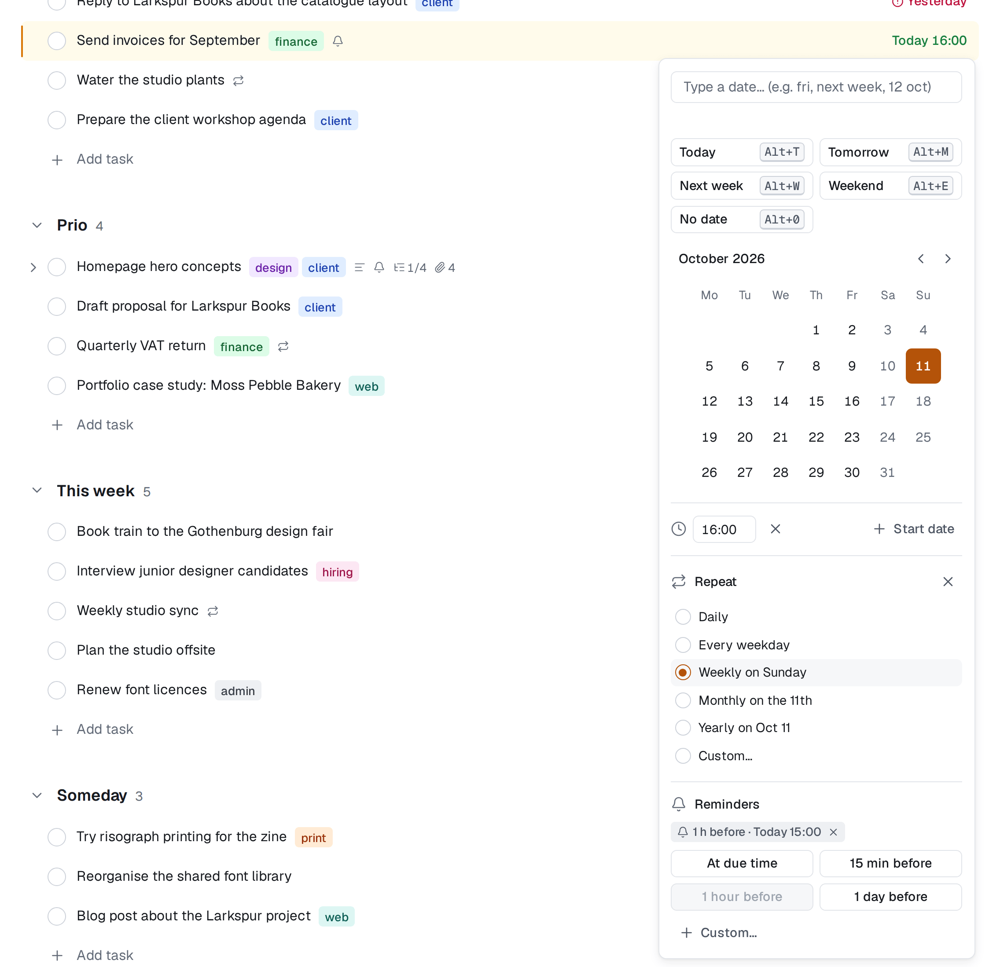
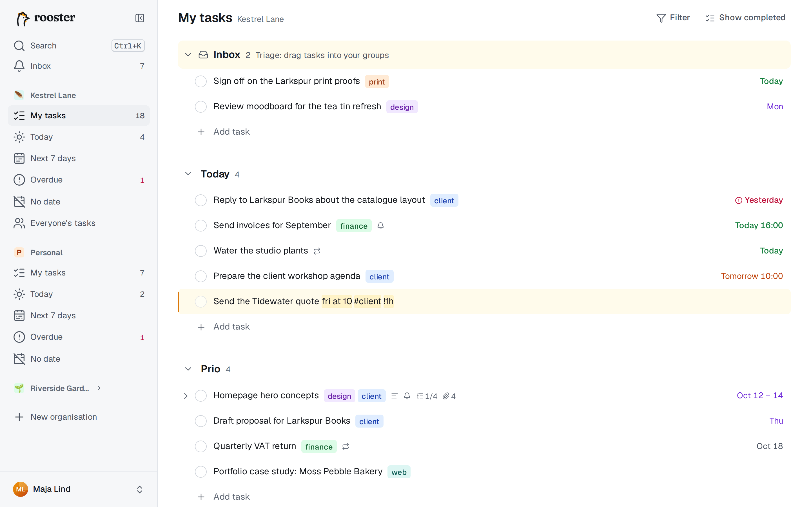

# Datum och återkommande uppgifter

En uppgift kan ha ett förfallodatum, ett klockslag, ett startdatum och en upprepning. Allt det kan du ställa in genom att skriva.

## Förfallodatum och klockslag

Ett förfallodatum är en kalenderdag, samma var du än befinner dig. Klockslaget är valfritt; med ett klockslag förfaller uppgiften vid just den tidpunkten, i den tidszon där det sattes.

Datumcellen till höger på varje rad visar en kort etikett:

| Etikett | Betyder |
|---|---|
| **Idag**, **Imorgon**, **Igår** | det som står |
| **fre** | inom den närmaste veckan |
| **12 okt** | senare i år |
| **12 okt 2027** | ett annat år |
| **Idag 14:00** | med klockslag (12- eller 24-timmarsklocka enligt din inställning) |
| **10–12 okt** | med startdatum |

Färgen visar hur bråttom det är: försenat är rött med en varningsikon, idag grönt, imorgon blått, den här veckan lila och senare grått. En uppgift som förfaller idag vid en tid som redan har passerat räknas som försenad. Håll muspekaren över etiketten för att se hela datumet.

Tidszon, veckans första dag, datumformat och tidsformat ställer du in under Inställningar → Profil.

## Datumväljaren

Klicka i datumcellen, eller tryck på **D** (eller **Tab+D** medan du redigerar), för att öppna datumväljaren.

1. **Skriv ett datum** i rutan överst. Under rutan ser du vad du får, eller *Det förstod jag inte*. Tryck på Enter för att välja det.
2. Eller använd ett snabbval: **Idag** (Alt+T), **Imorgon** (Alt+M), **Nästa vecka** (Alt+W), **I helgen** (Alt+E) eller **Inget datum** (Alt+0). På Mac är Alt ⌥.
3. Eller klicka på en dag i kalendern.

När du väljer ett datum stängs väljaren direkt. Under kalendern finns:

- **Tid**, som lägger till ett klockslag med förslag var 15:e minut.
- **Startdatum**, som gör kalendern till ett intervall: välj först startdatum, sedan förfallodatum. Du kan också skriva ett intervall, som `10–12 okt`. Startdatumet kan inte ligga efter förfallodatumet.
- **Upprepa**, som gör uppgiften återkommande (se nedan).
- **Påminnelse** (Alt+R), som lägger till påminnelser ([Påminnelser](./reminders.md)).

Så länge Tid eller Startdatum är öppet stannar väljaren kvar tills du trycker på Enter eller klickar utanför. Esc stänger utan att ändra något.

**För att ta bort ett datum** väljer du **Inget datum**, markerar datumcellen och trycker på backsteg eller Delete, eller klickar på **×** bredvid datumet i detaljpanelen. Ångra lägger tillbaka det.

## Skriva datum i uppgiftens namn

Skriv ett datum sist i uppgiftens namn, så förstår rooster det: `Ring banken fre` blir *Ring banken* med förfallodatum på fredag. Uttrycket markeras medan du skriver och tas bort ur namnet när du trycker på Enter.

**Var uttrycket får stå.** Veckodagar, relativa uttryck (*nästa vecka*, *om 3 dagar*) och upprepningar räknas bara **sist** i namnet, eventuellt följda av ett klockslag, `#taggar`, `@namn` eller en påminnelse. *Ring Bo mån* får alltså ett datum, men *Mån Repos hotellbokning* får det inte. Entydiga uttryck (*idag*, *imorgon*, *12 okt*, *2026-10-12*) får stå var som helst.

**När du inte vill ha ett datum.** Klicka på markeringen, eller tryck på backsteg direkt efter den, så blir den vanlig text. Eller omge orden med bakåtfnuttar: `` Läs `nästa vecka`-numret ``. Fnuttarna tas bort.

**Språk.** I uppgiftsnamn förstår rooster engelska ord fullt utskrivna oavsett språkinställning, och dessutom svenska ord och förkortningar när språket är svenska. Rutan i datumväljaren förstår alltid båda språken fullt ut. Datum med snedstreck som `12/10` fungerar bara i väljaren (och läses enligt ditt datumformat), så *1/2 dl mjöl* förblir ett namn.

### Det här kan du skriva

| Betydelse | Svenska | Engelska |
|---|---|---|
| idag | idag, i dag | today, tod |
| imorgon | imorgon, i morgon, imorn | tomorrow, tom, tmr |
| i övermorgon | övermorgon, i övermorgon | – |
| en veckodag (närmast efter idag) | måndag, mån, nästa måndag, på fredag | monday, mon, next mon, on fri |
| en veckodag, idag inräknat | – | this fri |
| nästa vecka (veckans första dag) | nästa vecka | next week |
| helgen (lördag) | helgen, i helgen, nästa helg | weekend, this weekend, next weekend |
| den första nästa månad | nästa månad | next month |
| om ett tag | om 3 dagar, om två veckor, om en månad, +3d, +2w, +1m | in 3 days, in 2 weeks, in a month |
| ett datum | 12 okt, 12 oktober, den 12 oktober, 2026-10-12 | oct 12, 12 oct, october 12th, 12 oct 2027 |
| slutet av perioden | slutet av veckan, slutet av månaden | end of week, end of month, eow, eom |
| med klockslag | fre kl 14, fre kl. 14.30, fre klockan 9 | fri at 14, fri at 14:30, fri 2pm |

Ett datum utan år betyder nästa gång det datumet infaller. Ett klockslag behöver *kl*, *klockan*, *at* eller *@* om det saknar minuter eller am/pm (`fre 14:30` fungerar). I datumväljaren betyder ett ensamt klockslag (`15:00`) idag vid den tiden.

## Återkommande uppgifter

En återkommande uppgift skapar nästa uppgift i serien när du markerar den som klar.

### Ställ in upprepning

- I datumväljaren eller på raden **Upprepa** i panelen väljer du ett förval: varje dag, varje vardag, varje vecka på förfallodagens veckodag, varje månad på samma dag eller varje år på samma datum.
- Välj **Anpassa…** för allt annat: var N:e dag, vecka, månad eller år; valda veckodagar; en dag i månaden eller den första, andra, tredje, fjärde eller sista veckodagen; **Räkna från när den blir klar**; och när serien **Slutar**: **Aldrig**, **Ett visst datum** eller **Efter ett antal gånger**.
- Eller skriv det sist i namnet:

| Svenska | Engelska |
|---|---|
| varje dag, dagligen | every day, daily |
| varje vardag | every weekday |
| varje måndag, varje måndag och torsdag | every mon, every mon and thu |
| varannan vecka, varannan fredag | every 2 weeks, every other fri |
| var tredje dag, var 3:e dag | every 3 days |
| varje månad, den 15:e varje månad | every month, every month on the 15th |
| varje sista fredag | every last fri |
| varje år, 12 okt varje år | every year, oct 12 every year |
| var 3:e dag efter klar | every 3 days after done |

En återkommande uppgift behöver ett förfallodatum. Skriver du bara en upprepning blir det första förfallodatumet den första dag från och med idag som passar. Återkommande uppgifter har en ↻-ikon på raden.

### Räkna från när den blir klar

Normalt följer nästa datum regeln räknat från förfallodatumet: en uppgift som förfaller varje måndag ligger kvar på måndagar även om du blir klar på onsdagen. Med **Räkna från när den blir klar** (eller *efter klar*) räknas nästa datum från dagen du markerar den som klar: "var 3:e dag efter klar" förfaller tre dagar efter att du senast gjorde den.

### När du markerar den som klar

Nästa uppgift i serien hamnar **direkt under** den klara, i samma grupp och med samma ansvarig. Den får samma namn, beskrivning, taggar, följare och deluppgifter (öppna igen), och de påminnelser som räknas från förfallodatumet. Kommentarer, bilagor och påminnelser vid en fast tid stannar på den gamla.

### Avsluta eller ta bort

- Ta bort upprepningen med **Sluta upprepa**, eller ta bort förfallodatumet: båda avslutar serien.
- När du tar bort en återkommande uppgift får du välja. **Ta bort den här uppgiften** tar bara bort den här, och serien fortsätter med nästa datum. **Ta bort den här och kommande** tar bort den och avslutar serien.
