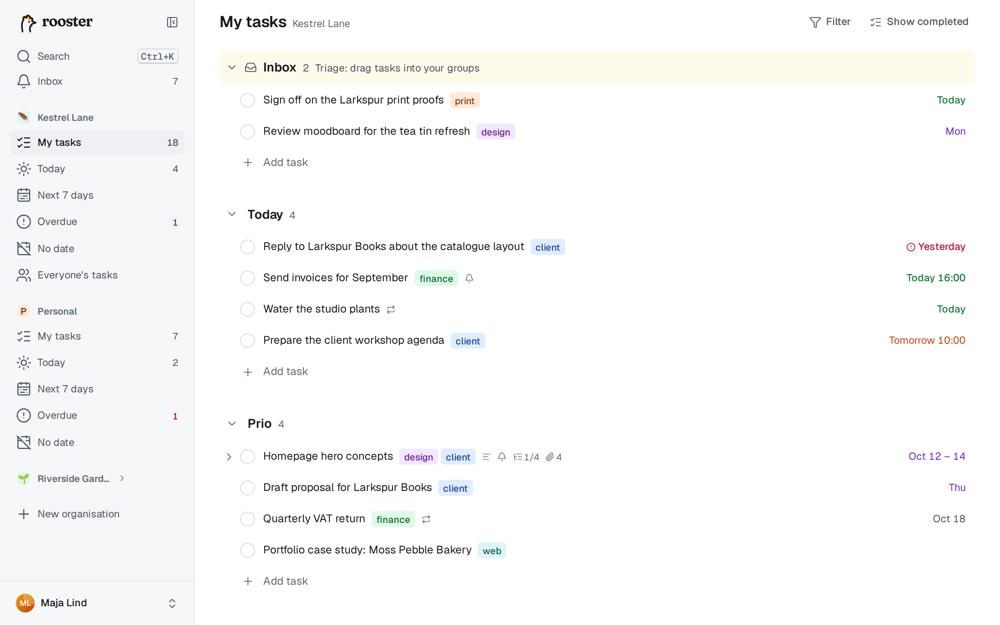

# Kom igång

rooster är en lugn uppgiftslista som är byggd för tangentbordet. Den fungerar som en textredigerare: du skriver en uppgift, trycker på Enter och skriver nästa. Datum, taggar och grupper skriver du direkt i namnet, och en sidopanel öppnas bara när du vill skriva mer.

## Logga in

1. Öppna adressen till ditt rooster (den får du av administratören).
2. Välj **Fortsätt med …** för din inloggningstjänst, till exempel Google eller företagets gemensamma inloggning. rooster har inga egna lösenord.
3. Första gången skapar rooster ditt konto, din organisation **Personligt** och tre grupper: *Idag*, *Prio* och *Kommande*.

rooster kräver inbjudan. Står det **Du är inte inbjuden än** får din e-postadress inte logga in här. Be någon i din organisation om en inbjudningslänk, eller be administratören att lägga till dig. En inbjudningslänk öppnar en sida där du väljer **Acceptera och logga in**.

## Organisationer

Varje uppgift hör till exakt en organisation. Använd dem för att hålla isär privata uppgifter och jobbuppgifter.

- **Personligt** är bara din. Den kan inte delas, döpas om eller tas bort, och den saknar allt som har med samarbete att göra.
- **Delade organisationer** har medlemmar som ser alla uppgifter i organisationen, tilldelar varandra uppgifter och kommenterar. Läs mer i [Samarbete](./collaboration.md).

Varje organisation är ett avsnitt i sidofältet, med Mina uppgifter, de smarta vyerna (Idag, Kommande 7 dagar, Försenade, Utan datum) och, i delade organisationer, Allas uppgifter. Dra i en organisations rubrik för att ändra ordningen. **Ctrl+1** till **Ctrl+9** (⌘ på Mac) går direkt till Mina uppgifter i de nio första organisationerna.

För att skapa en organisation väljer du **Ny organisation** i sidofältet, ger den namn, ikon och färg och trycker på **Skapa organisation**. Du blir ägare. Vill du bjuda in andra öppnar du organisationens **⋯**-meny och väljer **Bjud in personer**.

På mobilen byter du organisation uppe till vänster, se [Mobil och offline](./phone-and-offline.md).

## Listan är en textredigerare

En rad är antingen *markerad* (du flyttar dig med piltangenterna) eller *redigeras* (det finns en markör i namnet).

| För att | Gör så här |
|---|---|
| Börja redigera den markerade raden | Enter, F2 eller I, eller klicka på namnet |
| Lägga till en uppgift nedanför/ovanför | Enter/Skift+Enter medan du redigerar |
| Sluta redigera | Esc (namnet sparas) |
| Flytta mellan rader | ↑ ↓ (eller J och K) |
| Markera en uppgift som klar | Ctrl+Enter, eller klicka i rutan |
| Ångra | Ctrl+Z |

Allt sparas medan du skriver, och allt går att ångra. Tomma rader sparas aldrig, så ett Enter för mycket gör ingenting.

## Dina första fem minuter

1. Klicka på **Lägg till uppgift** under *Idag* och skriv `Ring banken imorgon`. Ordet *imorgon* markeras: tryck på Enter så får uppgiften morgondagens datum och ordet försvinner ur namnet.
2. Skriv `Planera veckan #jobb` och tryck på Enter. Taggen *jobb* skapas och läggs till.
3. Tryck på Esc, sedan ↑ för att markera *Ring banken*, och tryck på **D** för att öppna datumväljaren. Välj en dag, så stängs väljaren.
4. Tryck på **M** och välj *Prio* för att flytta uppgiften till en annan grupp. Eller dra den dit.
5. Tryck på **O** för att öppna uppgiften i detaljpanelen och skriv en beskrivning eller lägg till deluppgifter.
6. Tryck på Ctrl+Enter för att markera den som klar. Raden tonas bort efter en stund, och Ctrl+Z tar tillbaka den.

## Gå vidare

- [Mina uppgifter](./my-tasks.md): grupper, deluppgifter, taggar, flytta och ändra många på en gång.
- [Datum och återkommande uppgifter](./dates-and-repeats.md): allt du kan skriva som datum.
- [Vyer och sökning](./views-and-search.md): Idag, Kommande 7 dagar och kommandopaletten.
- [Kortkommandon](./keyboard.md): hela listan.

Tryck på **?** i listan för att se alla kortkommandon. Guiden finns också i appen: välj **Öppna guiden** i listan över kortkommandon, i användarmenyn eller i Inställningar, eller tryck G och sedan H. Den fungerar även offline.
