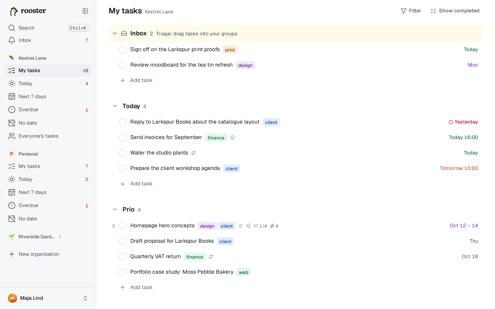
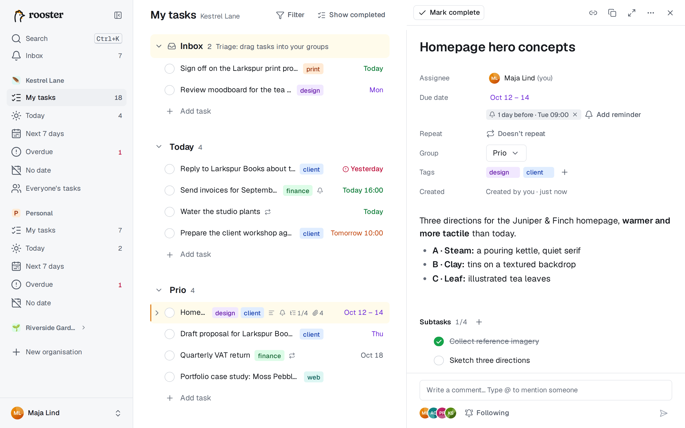

# Mina uppgifter

Mina uppgifter är din egen lista i en organisation: uppgifterna där du är ansvarig, ordnade i dina egna grupper och precis i den ordning du väljer. Ingenting sorteras om åt dig.

## Grupper

Grupperna är personliga. Två personer i samma organisation har var sina grupper och var sin ordning.

- **Skapa en grupp vid markören:** tryck på **Tab+N** (håll ned Tab och tryck på N). Den nya gruppen börjar direkt under den markerade uppgiften, och uppgifterna nedanför flyttas med till den nya gruppen.
- **Gör om en uppgift till en grupp:** skriv ett namn som slutar med kolon, till exempel `Väntar på:`, och tryck på Enter. En etikett ber dig trycka på Enter en gång till för att göra raden till en grupprubrik.
- **Lägg till en grupp sist:** välj **Lägg till grupp** längst ned i listan.
- **Byt namn:** klicka på gruppens namn, eller markera rubriken och tryck på F2.
- **Fäll ihop eller ut:** klicka på pilen, eller markera rubriken och tryck på ← eller →. Alt-klick fäller ihop eller ut alla grupper.
- **Ändra ordning:** dra i rubriken, eller markera den och tryck på Ctrl+↑/Ctrl+↓.
- **Ta bort:** öppna rubrikens **⋯**-meny och välj **Ta bort grupp**. En tom grupp försvinner direkt (och kan ångras). Har gruppen uppgifter väljer du att flytta dem till en annan grupp eller **Ta bort uppgifterna också**. Du har alltid minst en grupp kvar.

### Inkorgen

**Inkorgen** är en särskild grupp som ligger fast högst upp. Hit kommer uppgifter som saknar grupp: uppgifter som någon annan har tilldelat dig och uppgifter som har lagts till från kommandoraden eller av en AI-agent. Den syns inte när den är tom. Dra uppgifterna vidare till dina egna grupper för att sortera dem. Inkorgen kan inte döpas om, flyttas eller tas bort.

## Lägga till och redigera uppgifter

- **Enter** medan du redigerar lägger till en uppgift nedanför, **Skift+Enter** en ovanför. När en rad bara är markerad gör **N** och **Skift+N** samma sak, och **Q** (eller Tab+Q) lägger till en uppgift högst upp i den första gruppen.
- **Lägg till uppgift** sist i varje grupp lägger till en där.
- Klicka på ett namn för att redigera det. Ändringen sparas när du trycker på Enter eller Esc, går till en annan rad eller klickar någon annanstans.
- **Klistra in flera rader** i ett tomt namn, så erbjuder en etikett att skapa en uppgift per rad. Tryck på Enter för att godkänna, eller Esc för att klistra in texten som en enda rad.
- **Backsteg i ett tomt namn** tar bort raden, så länge uppgiften saknar beskrivning, deluppgifter, kommentarer och bilagor. Annars använder du Tab+Delete.

Medan du skriver ett namn kan du lägga till:

| Skriv | Det gör |
|---|---|
| ett datum, som `fre` eller `12 okt` | sätter förfallodatum ([Datum och återkommande uppgifter](./dates-and-repeats.md)) |
| `varje måndag` | gör uppgiften återkommande |
| `#tagg` | lägger till en tagg; förslag visas, och ett nytt namn skapar taggen |
| `@namn` | tilldelar uppgiften (delade organisationer) |
| `!1h` | lägger till en påminnelse ([Påminnelser](./reminders.md)) |

Det som känns igen markeras. Klicka på markeringen, eller tryck på backsteg direkt efter den, för att behålla den som vanlig text. Omge text med bakåtfnuttar (`` `nästa vecka` ``) så tolkas den inte alls.

## Deluppgifter

Deluppgifter är riktiga uppgifter med egna datum, taggar, beskrivning och deluppgifter, upp till fem nivåer djupt.

- **Tab+S** (eller **S** när raden är markerad) lägger till en deluppgift till den markerade uppgiften och låter dig skriva direkt. Enter i en deluppgift lägger till nästa.
- Pilen framför en överordnad uppgift visar eller döljer deluppgifterna i listan; ← och → gör samma sak från tangentbordet. rooster kommer ihåg vad du har fällt ut.
- Raden visar hur många som är klara, till exempel *2/5*.
- För att göra befintliga uppgifter till deluppgifter markerar du dem, öppnar kommandopaletten (Ctrl+K) och väljer **Gör till deluppgift av…**.
- En deluppgift där du är ansvarig men inte för den överordnade uppgiften visas som en egen rad, med den överordnade uppgiftens namn framför (*Överordnad ›*).

## Detaljpanelen

Panelen visar en uppgift i sin helhet: ansvarig, förfallodatum, upprepning, påminnelser, grupp, taggar, beskrivning, deluppgifter, bilagor och aktivitetsflödet.

- **Öppna den:** klicka på raden (inte på namnet), tryck på **O** (fokus flyttas till panelen), **blanksteg** (titta: panelen öppnas men fokus stannar i listan) eller **Tab+Enter** (redigera namnet i panelen).
- När panelen är öppen byter ↑ och ↓ i listan vilken uppgift den visar.
- **Beskrivning:** en redigerare som sparar Markdown. Markdown-genvägar fungerar medan du skriver (`# `, `- `, `[] `, `**fetstil**`). Markera text för att få fram formateringsverktygen. **Ctrl+klick** (⌘+klick) öppnar en länk; ett vanligt klick låter dig redigera länktexten. Långa beskrivningar fälls ihop efter ungefär 12 rader bakom **Visa mer**. Tab+R hoppar till beskrivningen.
- **Verktygsfältet:** **Markera som klar**, **Kopiera länk**, **Duplicera**, **Helskärm** (Tab+X) och **Fler åtgärder** (Ta bort uppgift, Kopiera uppgifts-ID, Öppna i ny flik, Flytta till grupp).
- Esc går tillbaka till listan, och Esc en gång till stänger panelen. Varje uppgift har en egen länk som du kan spara eller dela.

## Taggar

Taggar hör till en organisation och delas av alla dess medlemmar.

- Skriv `#namn` i ett uppgiftsnamn, eller tryck på **Tab+T** (eller **T** eller **#** när raden är markerad) för att välja taggar. Ett nytt namn skapar taggen.
- Taggarna visas som färgade etiketter efter namnet.
- **Filtrera** i listans rubrik visar bara uppgifter med de taggar du väljer.
- I Organisationsinställningar → **Taggar** kan du byta namn på, färga om, slå ihop och ta bort taggar.

## Markera uppgifter som klara

Klicka i rutan eller tryck på **Ctrl+Enter**. Raden stryks över, ligger kvar en stund och tonas sedan bort. **Ångra** i meddelandet (eller Ctrl+Z) tar tillbaka den till samma plats. En överordnad uppgift kan bli klar även om deluppgifterna är öppna; de påverkas inte.

**Visa klara** i listans rubrik (eller **Skift+H**) visar klara uppgifter gråade där de låg. Klicka i rutan för att öppna en igen.

## Flytta uppgifter

- **Dra** en rad i handtaget (det syns när du för muspekaren över raden), eller var som helst på raden utom namnet, rutan och datumet. Släpp den mellan uppgifter i valfri grupp, eller på en grupprubrik för att lägga den överst.
- **Med tangentbordet:**

| Tangenter | Flyttar uppgiften |
|---|---|
| Ctrl+↑/Ctrl+↓ | ett steg upp eller ned, även över gruppgränser |
| Ctrl+Skift+↑/Ctrl+Skift+↓ | sist i föregående grupp/först i nästa |
| Alt+Skift+↑/Alt+Skift+↓ | högst upp/längst ned i gruppen |
| M eller Tab+M | till en grupp du väljer (skriv för att filtrera, eller tryck på 1–9) |

Du kan också dra med bara tangentbordet: tabba till radens handtag, lyft med blanksteg, flytta med piltangenterna och släpp med blanksteg.

## Markera flera uppgifter

Skift-klick eller Skift+↑/↓ markerar ett intervall; Ctrl-klick eller **X** lägger till och tar bort enstaka uppgifter. **Ctrl+A** markerar gruppen, och en gång till allt. När två eller fler är markerade visas ett fält längst ned: **Klar**, **Datum**, **Flytta till**, **Tagga**, **Tilldela** (delade organisationer) och **Ta bort**. Esc avmarkerar.

## Ta bort och papperskorgen

Tryck på **Delete** (eller backsteg) på en markerad rad, eller **Tab+Delete** medan du redigerar. Borttagna uppgifter hamnar i organisationens papperskorg, där de ligger kvar i 30 dagar. Du återställer dem under Inställningar → Data ([Inställningar och dina data](./settings-and-data.md)).

## Ångra och gör om

**Ctrl+Z** ångrar din senaste ändring, och **Ctrl+Skift+Z** (eller Ctrl+Y) gör om den. rooster kommer ihåg de 50 senaste ändringarna under sessionen: skapa, byta namn, sätta datum, flytta, markera som klar, ta bort, tagga och ändringar av grupper. Ångra fungerar även offline. Medan du skriver i ett fält ångrar Ctrl+Z först det du har skrivit.

På Mac använder du ⌘ överallt där det står Ctrl. Alla kortkommandon finns under [Kortkommandon](./keyboard.md).
