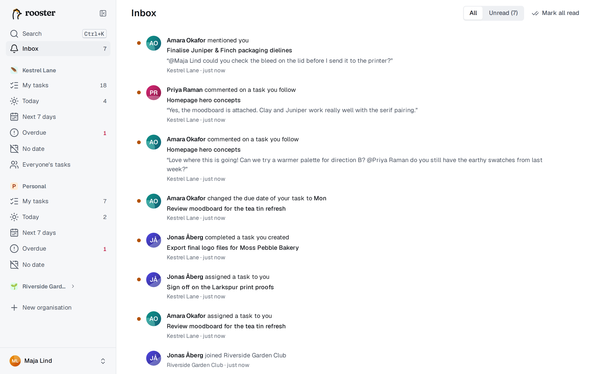
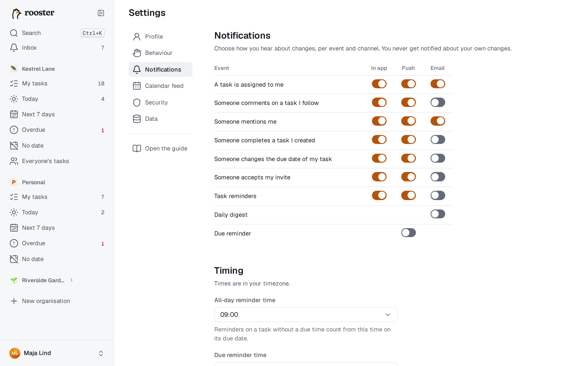

# Aviseringar

rooster säger till när något händer som rör dig: i appens **inkorg**, som **pushavisering** på dina enheter och via **e-post** om din server skickar e-post. Du väljer själv vilka händelser som når dig i vilken kanal.

Du aviseras aldrig om dina egna ändringar. Det enda undantaget är [påminnelser](./reminders.md), som du ju sätter åt dig själv.

## Inkorgen

**Inkorgen** samlar aviseringar från alla dina organisationer. Öppna den från sidofältet på datorn (eller tryck `G` och sedan `I`), eller från fliken Inkorg i menyraden längst ner på mobilen. Siffran visar hur många som är olästa.

Du får en avisering när:

| Händelse | Exempel |
|---|---|
| En uppgift tilldelas dig | ”Amara tilldelade dig en uppgift” |
| Någon kommenterar en uppgift du följer | med början av kommentaren |
| Någon nämner dig | i en kommentar, med `@ditt namn` |
| Någon slutför en uppgift du skapade | |
| Någon ändrar förfallodatum för din uppgift | med det nya datumet |
| Någon tackar ja till din inbjudan | ”Jonas gick med i Studio” |
| En av dina påminnelser är dags | ”Påminnelse”, med tiden |

- Klicka på en avisering för att öppna uppgiften. Aviseringen markeras som läst.
- Med knappen på varje avisering markerar du den som läst eller oläst, och **Markera alla som lästa** finns överst.
- **Visa: Alla / Olästa** filtrerar listan.

Tilldelningar, kommentarer och omnämnanden finns bara i delade organisationer, så i din personliga organisation får du bara påminnelser. Läs om att följa uppgifter i [Samarbete](./collaboration.md).

## Pushaviseringar

Push slås på per enhet: gör det för varje telefon och dator där du vill ha aviseringar.

1. Öppna **Inställningar → Aviseringar** på enheten.
2. Välj **Slå på push för den här enheten** och tillåt aviseringar när webbläsaren frågar.
3. Kontrollera att det fungerar med **Skicka test** bredvid enheten.

Under **Dina enheter** ser du alla enheter med push påslaget och när något senast levererades dit. **Ta bort** stänger av push för en enhet. Trycker du på en pushavisering öppnas uppgiften.

- **iPhone och iPad:** push fungerar bara i den installerade appen. Lägg först till rooster på hemskärmen (se [Mobil och offline](./phone-and-offline.md#installera-appen)) och slå sedan på push därifrån.
- **Blockerat?** Om du en gång har nekat aviseringar tillåter du dem för rooster i webbläsarens webbplatsinställningar (på iOS: appen Inställningar → Notiser) och läser in sidan igen.
- När du loggar ut stängs push av för den enheten.

## E-post

E-post finns bara om serverns administratör har konfigurerat det. Annars visas ingen e-postkolumn.

- **Aviseringar via e-post** skickas **Direkt**, eller samlas i ett e-postmeddelande **Var 15:e minut** (standard). Det ändrar du under **Tider**.
- **Daglig sammanfattning:** ett e-postmeddelande om dagen med det som förfaller idag, det som är försenat och det som är nytt i inkorgen.
- Varje e-postmeddelande har en länk för att avsluta just den sortens utskick. Du får bekräfta innan prenumerationen avslutas, och du kan slå på utskicken igen i Inställningar → Aviseringar.

## Välj vad du får

**Inställningar → Aviseringar** har ett rutnät med händelser och kanaler: **I appen**, **Push** och **E-post**. Kryssa i det du vill ha; ändringarna sparas direkt.

Som standard gäller:

| | I appen | Push | E-post |
|---|---|---|---|
| Tilldelningar och omnämnanden | på | på | på |
| Kommentarer, slutförda uppgifter, ändrade förfallodatum, accepterade inbjudningar | på | på | av |
| Påminnelser om uppgifter | på | på | av |
| Daglig sammanfattning (bara e-post) | | | av |
| Påminnelse om dagens uppgifter (bara push) | | av | |

Två rader är tillval snarare än händelser:

- **Påminnelse om dagens uppgifter** (push): varje morgon en pushavisering som listar dagens uppgifter.
- **Daglig sammanfattning** (e-post): sammanfattningen som beskrivs ovan.

Tiderna ställer du in under **Tider**, i din egen tidszon:

| Inställning | Standard |
|---|---|
| Tid för påminnelsen | 08:00 |
| Tid för den dagliga sammanfattningen | 07:00 |
| Påminnelsetid för heldagsuppgifter | 09:00 |

**Påminnelsetid för heldagsuppgifter** avgör när påminnelser går i väg för uppgifter som har ett förfallodatum men inget klockslag; se [Påminnelser](./reminders.md).
