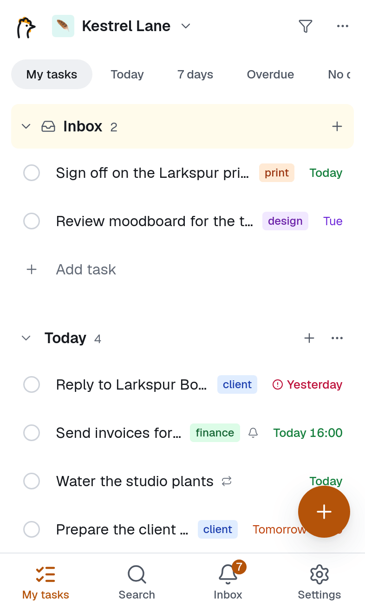
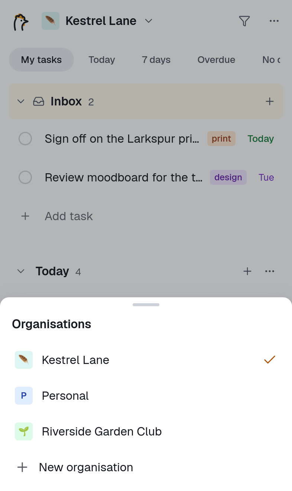
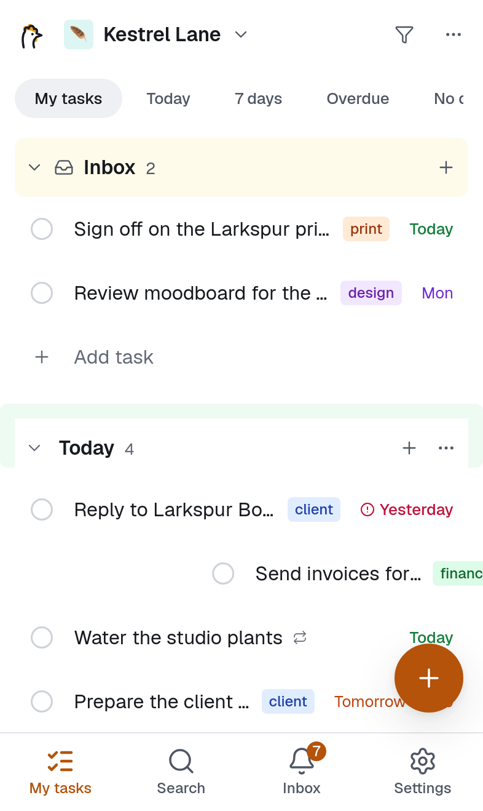
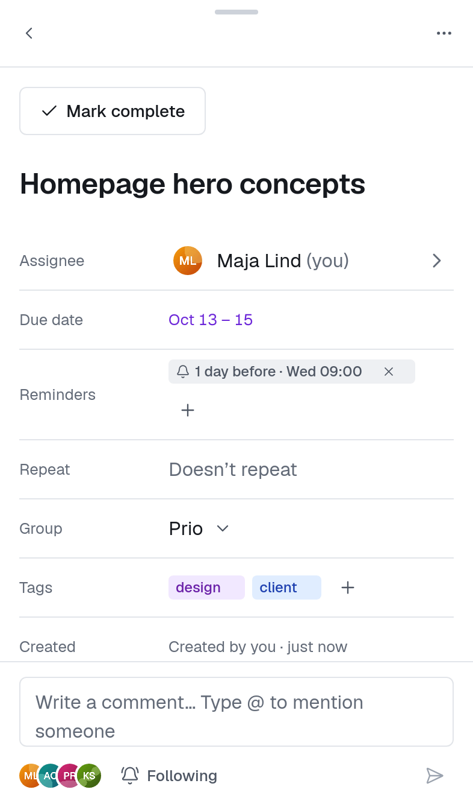

# Mobil och offline

rooster fungerar i alla moderna webbläsare och kan installeras som app på telefoner, surfplattor och datorer. När du väl har använt den fortsätter den att fungera utan anslutning och synkar dina ändringar när du är online igen.

## Installera appen

- **Android (Chrome):** välj **Installera** när rooster föreslår det, eller *Installera app* / *Lägg till på startskärmen* i webbläsarens meny.
- **iPhone och iPad (Safari):** tryck på **Dela** i Safaris verktygsfält, välj **Lägg till på hemskärmen** och sedan **Lägg till**.
- **Dator (Chrome, Edge):** använd installationsikonen i adressfältet, eller **Inställningar → Profil → Installera appen**.

Under **Inställningar → Profil → Installera appen** står också hur det går till på just din enhet.

På iPhone och iPad har den installerade appen egen lagring, så du loggar in en gång till efter installationen. Där behövs den installerade appen också för [pushaviseringar](./notifications.md#pushaviseringar).

## Mobilvyn

- **Sidhuvudet:** organisationsväljaren till vänster (tryck på namnet för att byta organisation eller skapa en **Ny organisation**), och till höger synkstatus och menyn **Mer**. Byt snabbare genom att svepa namnet åt vänster eller höger till nästa eller föregående organisation (prickarna under namnet visar var du är), eller håll på namnet, dra fingret till en organisation och släpp. Du stannar i samma vy, så Idag förblir Idag.
- **Vyväljaren:** Mina uppgifter · Idag · 7 dagar · Försenade · Utan datum · Alla. Den ligger kvar högst upp när du skrollar.
- **Menyraden längst ner:** Mina uppgifter · Sök · Inkorg · Inställningar.
- **Plusknappen (+):** lägger till en uppgift överst i den första gruppen, eller i vyn du står i. Tangentbordet öppnas med en rad ovanför: **Datum**, **Grupp**, **Lägg till tagg** och **Nästa**. **Nästa** sparar uppgiften och påbörjar en ny; tryck utanför för att sluta. Datum som du skriver i rubriken fungerar som på datorn; se [Datum och återkommande uppgifter](./dates-and-repeats.md).

## Gester

| Gest | Vad som händer |
|---|---|
| Tryck på en uppgift | Öppnar den i helskärm |
| Tryck på cirkeln | Markerar uppgiften som klar, med **Ångra** i meddelandet längst ner |
| Svep åt höger | Markera som klar (standard) |
| Svep åt vänster | Välj datum (standard): Idag, Imorgon, I helgen, Nästa vecka, Välj datum…, Inget datum |
| Håll kvar och dra | Flyttar uppgiften; drar du nära över- eller underkanten skrollar listan. Fungerar också på en uppgift du just har skrivit: håll kvar på namnet så läggs den till och kan flyttas. |
| Håll kvar och släpp | Markeringsläge: tryck på uppgifter för att markera dem och gör sedan något med alla på en gång från raden längst ner. **Avsluta markering** lämnar läget. |
| Dra nedåt högst upp | Uppdaterar listan och skickar väntande ändringar |

Vad svepen gör väljer du under **Inställningar → Beteende**: Markera som klar, Välj datum, Flytta till grupp, Ta bort eller Ingenting.

## Uppgiften i helskärm

När du trycker på en uppgift öppnas den i helskärm med allt som panelen har på datorn: datum, upprepning och påminnelser, taggar, beskrivning, deluppgifter, bilagor och kommentarer. Fälten öppnar paneler underifrån i stället för små popuprutor. Stäng med tillbakaknappen högst upp, genom att svepa nedåt uppifrån, eller med telefonens bakåtgest.

## Surfplattor

På en surfplatta är sidofältet en smal list som fälls ut över innehållet, och uppgifter öppnas i en panel som glider in från höger. I övrigt fungerar allt som på en dator, tangentbordet också.

## Offline

När rooster har hämtat dina listor kan du fortsätta utan anslutning:

- **Det här kan du läsa:** dina listor i alla organisationer, de smarta vyerna, grupper och taggar, och uppgifter som du har öppnat nyligen. Sökningen fungerar också, bland uppgifterna på enheten.
- **Det här kan du ändra:** uppgifter, grupper, taggar, deluppgifter, kommentarer och vad du följer. Varje ändring sparas på enheten och skickas automatiskt när anslutningen är tillbaka.
- **Det här kräver anslutning:** inkorgen, inställningar, bilagor, export och papperskorgen, och att logga in eller ut.

Synkstatusen i sidhuvudet visar vad som händer:

| Status | Betydelse |
|---|---|
| (ingenting) | Allt är sparat på servern. |
| **Offline** | Ingen anslutning, inget väntar. |
| **Offline · 3 väntande** | Ingen anslutning; 3 ändringar skickas senare. |
| **Synkar…** | Anslutningen är tillbaka och ändringarna skickas. |
| **Synkproblem · Försök igen** | Servern tog inte emot ändringarna efter flera försök. Tryck på **Försök igen**. |

Om två personer ändrar samma fält vinner den senaste ändringen. Om en väntande ändring inte längre går att genomföra, till exempel för att någon har tagit bort uppgiften under tiden, ångrar rooster den på din enhet och berättar varför (”Kunde inte spara … – den har tagits bort”).

Logga inte ut medan ändringar väntar: när du loggar ut rensas det som är sparat på enheten, också ändringar som inte har skickats.

## Uppdateringar

När en ny version av rooster har installerats på servern visas **Ny version tillgänglig · Ladda om**, och knappen **Uppdatera** ligger kvar i sidhuvudet tills du laddar om. rooster laddar aldrig om av sig själv medan du skriver eller medan ändringar väntar, utan så snart de är sparade.
