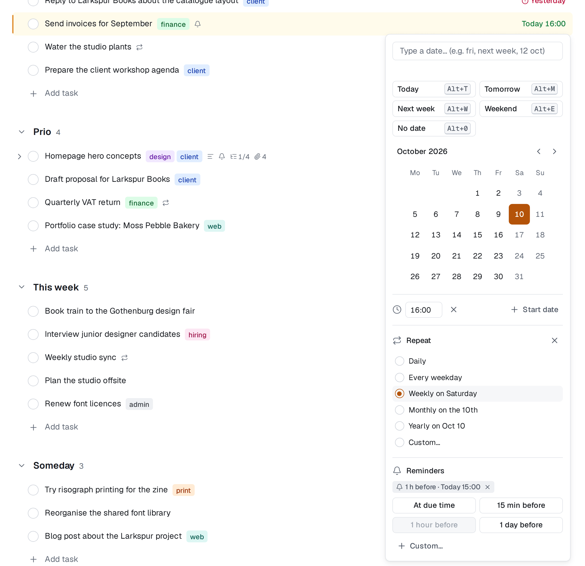

# Påminnelser

En påminnelse hör av sig om en uppgift vid den tidpunkt du väljer. Påminnelser är personliga: bara du ser de påminnelser du lägger till, och bara du blir påmind. Du kan sätta dem på alla uppgifter du ser, inte bara dina egna.

## Två sorter

- **Före förfallodatumet:** *vid förfallotiden*, *15 min före*, *1 timme före*, *1 dag före* eller valfri annan tid (upp till fyra veckor). De följer uppgiften: flyttar du förfallodatumet flyttas påminnelsen med.
- **Vid en fast tidpunkt:** en dag och tid du väljer, till exempel *fredag 14:00*. Det är den enda sorten en uppgift utan förfallodatum kan ha.

En uppgift kan ha högst fem påminnelser från dig.

## Lägg till en påminnelse

**Medan du skriver ett namn** lägger du till en kod sist:

| Kod | Påminner dig |
|---|---|
| `!15m` | 15 minuter före förfallotiden |
| `!1h` | 1 timme före |
| `!1d` | 1 dag före |
| `!due` | vid förfallotiden |

Vilket tal som helst fungerar (`!90m`, `!2h`, `!3d`). Koden markeras som ett datum och tas bort när du trycker på Enter. Den kräver ett förfallodatum, så kombinera den med ett: `Skicka offerten fre 14:00 !1h`. Ett vanligt utropstecken är bara text, så *Kör!* förblir som det är.

**I datumväljaren** väljer du **Påminnelse** (Alt+R). Där ser du uppgiftens påminnelser som etiketter (till exempel *1 tim före · fre 13:00*) och förval: **Vid förfallotiden** (uppgifter med klockslag), **15 min före**, **1 timme före**, **1 dag före**, **Samma dag kl. 09:00** (uppgifter utan klockslag) och **Anpassa…**, där du skriver en tid före, som `2h` eller `3d`, eller en tidpunkt, som `fre 14:00`. Väljaren stannar öppen medan du lägger till påminnelser; Esc eller ett klick utanför stänger den.

**I detaljpanelen** visar raden **Påminnelser** under förfallodatumet när varje påminnelse kommer, och där finns **Lägg till påminnelse**.

Ta bort en påminnelse genom att ta bort dess etikett.

En rad med en påminnelse som inte har skickats än visar en liten **klocka**. Håll muspekaren över den för att se när nästa kommer.

## Uppgifter utan klockslag

För en uppgift med datum men utan klockslag räknas "före" från en tid på dagen som du väljer: **Påminnelsetid för heldagsuppgifter** under Inställningar → Aviseringar (09:00 om du inte ändrar den). *1 dag före* på en uppgift som förfaller på fredag påminner dig då på torsdag kl. 09:00.

## När förfallodatumet försvinner

Tar du bort förfallodatumet **pausas** påminnelserna som räknas från det: de skickas inte, och deras etiketter visas nedtonade med *behöver ett förfallodatum*. Sätt ett datum igen så kommer de tillbaka. Påminnelser vid en fast tidpunkt påverkas inte.

## Var påminnelserna hamnar

En påminnelse skickas en gång, som en avisering: i din [inkorg](./collaboration.md#inkorgen), som pushnotis på de enheter där du har slagit på push, och via e-post om du vill. Raden **Påminnelser om uppgifter** under Inställningar → Aviseringar styr vilka; från början är i appen och push påslagna och e-post avslagen. Se [Aviseringar](./notifications.md).

- Klara och borttagna uppgifter påminner aldrig.
- Till skillnad från andra aviseringar får du påminnelser om sådant du själv har ställt in; det är ju meningen.
- Om servern låg nere när en påminnelse skulle skickas, skickas den när servern är igång igen, upp till 24 timmar sent, och märks *skickades sent*.

## Återkommande uppgifter

När du markerar en återkommande uppgift som klar får nästa uppgift i serien med sig dina påminnelser som räknas från förfallodatumet, anpassade till det nya datumet. Påminnelser vid en fast tidpunkt följer inte med. Se [Datum och återkommande uppgifter](./dates-and-repeats.md#återkommande-uppgifter).
