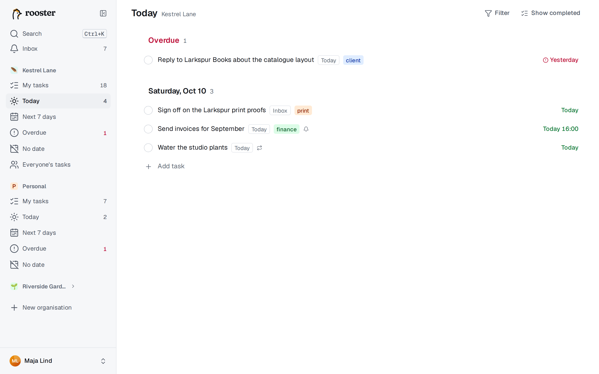
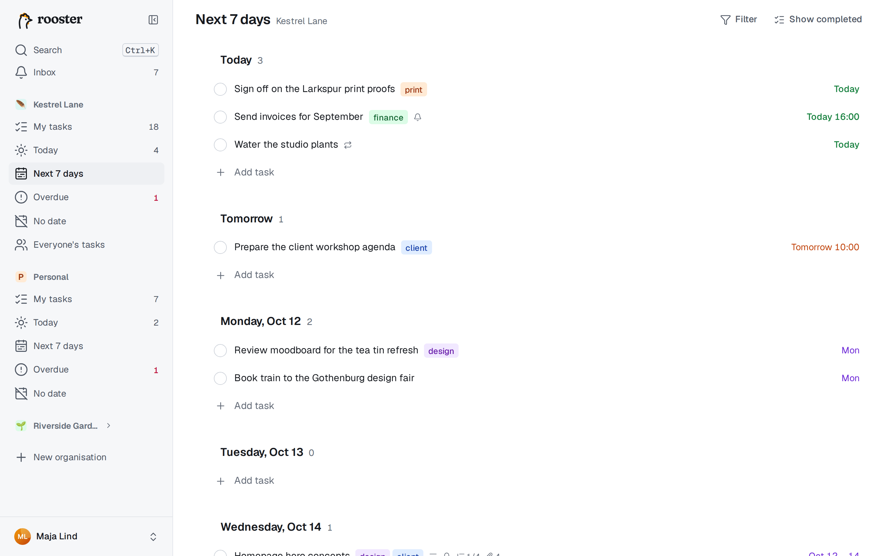
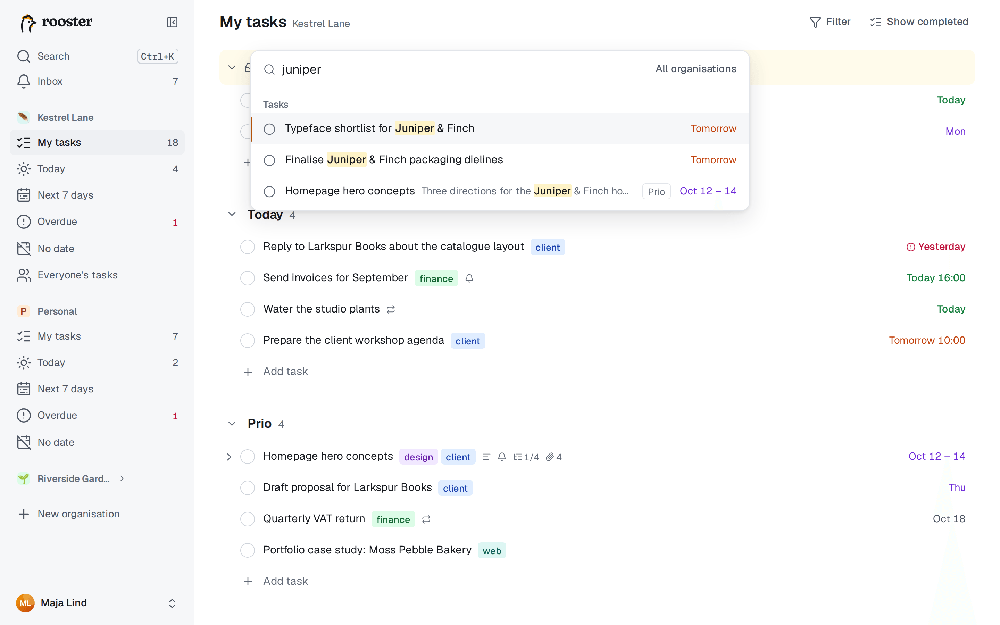

# Vyer och sökning

Förutom Mina uppgifter har varje organisation fyra **smarta vyer** som ordnar dina uppgifter efter datum, och kommandopaletten hittar vad som helst med några tangenttryck.

## Smarta vyer

De smarta vyerna visar dina uppgifter (de i Mina uppgifter, inklusive deluppgifter där du är ansvarig) grupperade efter datum. De ändrar aldrig dina grupper eller din ordning i Mina uppgifter. Raderna fungerar som vanligt: markera som klar, byt datum, tagga eller öppna dem. Det går inte att dra i de här vyerna, eftersom de är sorterade; byt datum med **D** i stället.

| Vy | Visar | Gå dit |
|---|---|---|
| **Idag** | avsnittet *Försenade* och sedan allt som förfaller idag (under dagens datum) | G, sedan T |
| **Kommande 7 dagar** | ett avsnitt per dag: Idag, Imorgon och sedan varje veckodag | G, sedan W |
| **Försenade** | allt som har passerat förfallodatumet, äldst först | G, sedan O |
| **Utan datum** | uppgifter utan förfallodatum, i samma ordning som i Mina uppgifter | G, sedan N |

Varje rad visar sin grupp som en liten etikett. I sidofältet räknas öppna uppgifter för Idag och Försenade (antalet försenade visas i rött), så du ser direkt om något behöver tas om hand. Klara uppgifter syns inte om du inte slår på **Visa klara**.

**Lägga till uppgifter i en vy.** En uppgift som läggs till i Idag förfaller idag, i en dag under Kommande 7 dagar på den dagen och i Utan datum utan datum. Den hamnar i din inkorg; vill du lägga den i en grupp avslutar du namnet med `>Grupp`, till exempel `Beställ toner >Prio`.

## Allas uppgifter

Delade organisationer har också **Allas uppgifter**, alla öppna uppgifter grupperade per person (G, sedan E). Se [Samarbete](./collaboration.md#allas-uppgifter).

## Kommandopaletten

Tryck på **Ctrl+K** (⌘K på Mac), klicka på **Sök** i sidofältet eller tryck på **/** när inget textfält har fokus.

- Med en tom ruta visas dina **senaste** uppgifter och de **kommandon** du kan använda, även de som gäller den markerade uppgiften.
- Skriv för att söka uppgifter. Träffarna visar namn, grupp eller organisation och förfallodatum. Enter öppnar uppgiften i sin lista.
- Börja med `>` för att bara söka bland kommandon: gå till en vy eller organisation, skapa en uppgift, visa klara uppgifter, öppna papperskorgen, exportera och alla uppgiftskommandon, som **Gör till deluppgift av…**. Kortkommandona visas bredvid.
- Sökningen gäller den aktuella organisationen. Slå på **Alla organisationer** för att söka i alla.

## Sökregler

Sökningen letar i namn, beskrivningar och kommentarer. Varje ord matchar början av ord (`tand` hittar *tandläkare*), utan hänsyn till versaler och accenter. Använd citattecken för att hålla ihop en fras: `"kvartalets rapport"`.

| Filter | Hittar |
|---|---|
| `#tagg` | uppgifter med taggen (flera `#`-filter måste alla stämma) |
| `@namn` | uppgifter där personen är ansvarig (namn eller e-post); `@me` för dina egna |
| `due:idag` | förfaller idag eller tidigare, som vyn Idag |
| `due:vecka` | förfaller inom sju dagar |
| `due:försenade` | har passerat förfallodatumet |
| `due:utan` | saknar förfallodatum |
| `is:öppen` / `is:klar` | bara öppna/bara klara uppgifter |

Utan `is:` kommer även klara uppgifter med, efter de öppna. De engelska orden fungerar också: `due:today`, `due:week`, `due:overdue`, `due:none`, `is:open`, `is:done`.

Exempel: `faktura #ekonomi due:vecka` hittar uppgifter som nämner *faktura*, är taggade *ekonomi* och förfaller inom en vecka.

## Offline

Utan anslutning söker paletten bland de uppgifter som finns sparade på enheten och visar *Offline – visar sparade uppgifter*. Se [Mobil och offline](./phone-and-offline.md).
