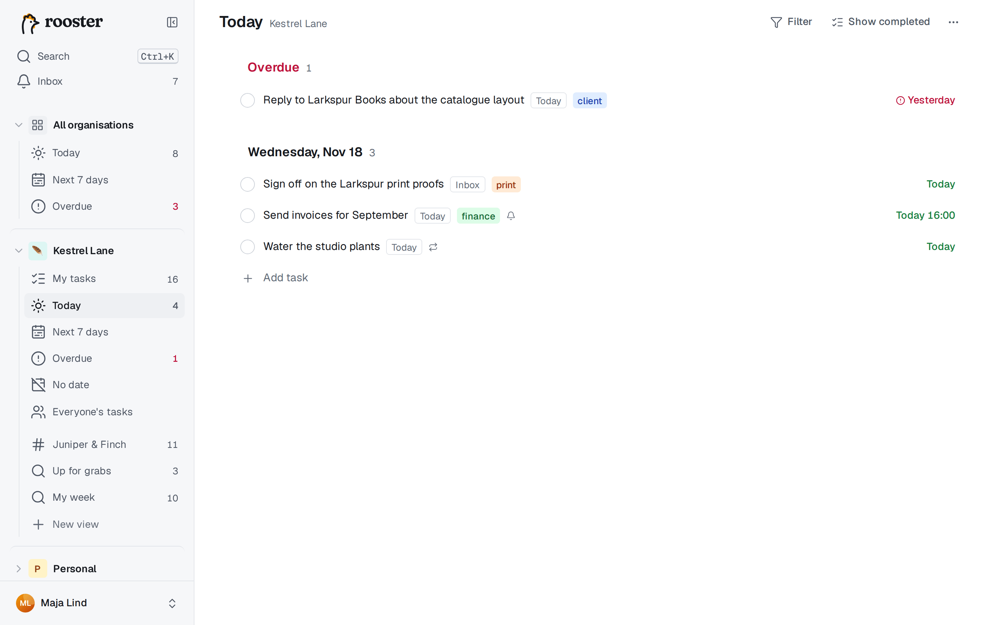
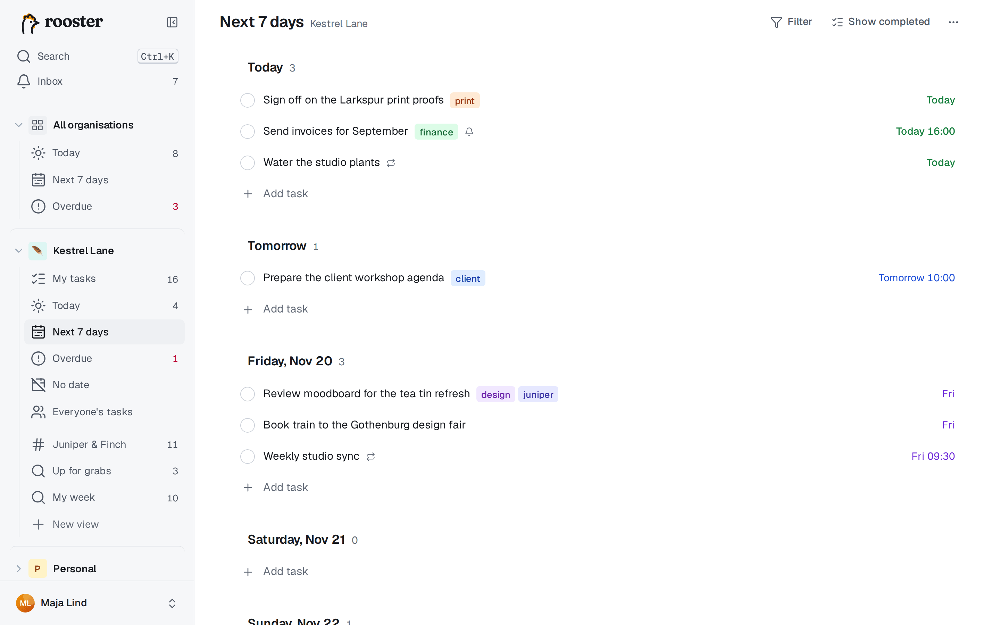
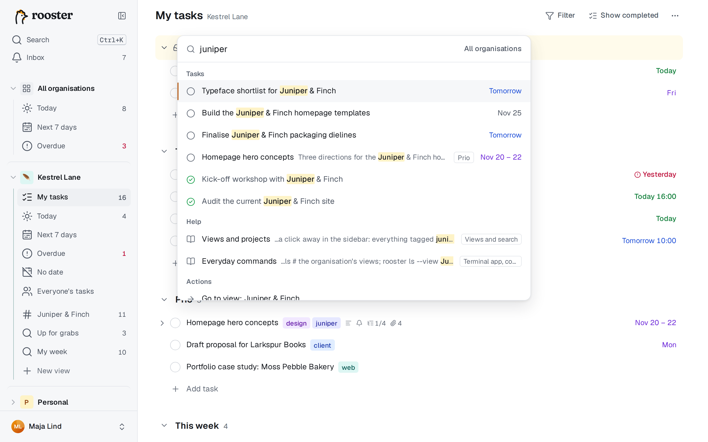

# Vyer och sökning

Förutom Mina uppgifter har varje organisation fyra **smarta vyer** som ordnar dina uppgifter efter datum, och kommandopaletten hittar vad som helst med några tangenttryck.

## Smarta vyer

De smarta vyerna visar dina uppgifter (de i Mina uppgifter, inklusive deluppgifter där du är ansvarig) grupperade efter datum. De ändrar aldrig dina grupper eller din ordning i Mina uppgifter. Raderna fungerar som vanligt: markera som klar, byt datum, tagga eller öppna dem. Det går inte att dra i de här vyerna, eftersom de är sorterade; byt datum med **D** i stället.

| Vy | Visar | Gå dit |
|---|---|---|
| **Idag** | avsnittet *Försenade* och sedan allt som förfaller idag (under dagens datum) | G, sedan T |
| **Kommande 7 dagar** | ett avsnitt per dag: Idag, Imorgon och sedan varje veckodag | G, sedan W |
| **Försenade** | allt som har passerat förfallodatumet, äldst först | G, sedan O |
| **Utan datum** | uppgifter utan förfallodatum, i samma ordning som i Mina uppgifter | G, sedan N |

Varje rad visar sin grupp som en liten etikett. I sidofältet räknas öppna uppgifter för Idag och Försenade (antalet försenade visas i rött), så du ser direkt om något behöver tas om hand. Klara uppgifter syns inte om du inte slår på **Visa klara**.

**Lägga till uppgifter i en vy.** En uppgift som läggs till i Idag förfaller idag, i en dag under Kommande 7 dagar på den dagen och i Utan datum utan datum. Den hamnar i din inkorg; vill du lägga den i en grupp avslutar du namnet med `>Grupp`, till exempel `Beställ toner >Prio`.

## Alla organisationer

Är du med i mer än en organisation finns **Alla organisationer** högst upp i sidofältet, med Idag, Kommande 7 dagar och Försenade för alla på en gång: ett ställe där du ser vad som förfaller, oavsett om det gäller jobbet, hemmet eller föreningen. Siffrorna räknar ihop alla organisationer.

- Avsnitten är desamma som i varje organisations vyer (Försenade och sedan Idag; ett avsnitt per dag), med alla organisationers uppgifter blandade efter datum. Varje rad har en liten etikett med organisationens avatar.
- Raderna fungerar som vanligt: markera som klar, byt datum, tagga, tilldela eller öppna dem. Varje ändring sparas i uppgiftens egen organisation, och allt fungerar utan uppkoppling.
- **En ny uppgift** hamnar i din **standardorganisation** (Personligt, om du inte ändrar det under [Inställningar → Beteende](./settings-and-data.md#beteende)). Den nya raden visar organisationen som en dämpad etikett. Vill du välja en annan skriver du `^` och dess namn: `Boka lokalen ^Kestrel`. Förslag visas medan du skriver, och etiketten följer med. Uppgiften hamnar i organisationens inkorg, eller i en grupp du anger med `>Grupp`.
- Utan datum och Mina uppgifter finns kvar i varje organisation: de handlar om var en uppgift är sorterad.
- Med tangentbordet öppnar du paletten (Ctrl+K) och väljer **Alla organisationer: Idag** (eller Kommande 7 dagar, Försenade). Vill du att rooster startar på Alla organisationer · Idag, se [Beteende](./settings-and-data.md#beteende).

## Vyer och projekt

En **vy** samlar de uppgifter i en organisation som matchar några filter och håller dem ett klick bort i sidofältet: allt som är taggat *juniper*, det som saknar ansvarig, det du gjorde klart den här veckan. Den flyttar aldrig uppgifter: de ligger kvar i var och ens grupper.

- **Skapa en** med **+ Ny vy** under organisationen i sidofältet, eller med **Spara som vy** från taggfiltret i Mina uppgifter, från filtren i Allas uppgifter eller från en sökning i paletten som använder filter (`#juniper @amara due:vecka`). Ge den ett namn och välj sedan vad den ska samla med etiketterna under namnet: **Taggar** (någon av eller alla), **Ansvarig** (vem som helst, jag, ingen eller en medlem), **Förfaller** och **Status**.
- **Privat eller Delad:** en privat vy är bara din. En delad syns i alla medlemmars sidofält, och alla medlemmar kan ändra, arkivera eller ta bort den. Att dela en vy visar inget nytt: alla i en organisation kan se alla dess uppgifter ändå; en vy samlar dem bara. I din personliga organisation är alla vyer privata.
- **Raderna** grupperas per person (du först, sedan de andra efter namn, sist *Ingen ansvarig*), var och en efter förfallodatum. En uppgift syns när den själv matchar: en taggad deluppgift syns under sin egen ansvarige med förälderns namn, och en taggad uppgift tar inte med sina otaggade deluppgifter. Klara uppgifter döljs tills du slår på **Visa klara**. Raderna fungerar som överallt annars.
- **En projektvy** är en vy med exakt en tagg. En uppgift du lägger till i den får taggen och personen i avsnittet där du skrev den (överst i personens inkorg; under *Ingen ansvarig* förblir den utan ansvarig), och rubriken visar hur det går: ”7 öppna · 12 klara”. När projektet är klart väljer du **⋯ → Arkivera vyn**: vyn försvinner ur alla sidofält, och [Organisationsinställningar → Vyer](./settings-and-data.md#organisationsinställningar) tar tillbaka den.
- **Din egen ordning:** dra vyerna i sidofältet (eller lyft en med handtaget från tangentbordet) för att ordna dem; varje medlem har sin egen ordning. Siffran vid en vy räknar dess öppna uppgifter.
- **Taggarna ändras, vyerna följer med:** en tagg som byter namn finns kvar i sina vyer, en sammanslagen ersätts av taggen den gick upp i, och en borttagen tagg försvinner ur alla vyer.
- Med tangentbordet har paletten (Ctrl+K) **Gå till vy**, **Ny vy**, **Spara sökningen som vy** och alla åtgärder för den öppna vyn.

## Allas uppgifter

Delade organisationer har också **Allas uppgifter**, alla öppna uppgifter grupperade per person (G, sedan E). Se [Samarbete](./collaboration.md#allas-uppgifter).

## Kommandopaletten

Tryck på **Ctrl+K** (⌘K på Mac), klicka på **Sök** i sidofältet eller tryck på **/** när inget textfält har fokus.

- Med en tom ruta visas dina **senaste** uppgifter och de **kommandon** du kan använda, även de som gäller den markerade uppgiften.
- Skriv för att söka uppgifter. Träffarna visar namn, grupp eller organisation och förfallodatum. Enter öppnar uppgiften i sin lista.
- Under uppgifterna visar **Hjälp** de bästa träffarna i den här guiden. Enter öppnar sidan vid det avsnittet. Alla träffar ser du om du söker på [guidens egna sidor](./getting-started.md).
- Börja med `>` för att bara söka bland kommandon: gå till en vy eller organisation, skapa en uppgift, visa klara uppgifter, öppna papperskorgen, exportera och alla uppgiftskommandon, som **Gör till deluppgift av…**. Kortkommandona visas bredvid.
- Sökningen gäller den aktuella organisationen. Slå på **Alla organisationer** för att söka i alla.

## Sökregler

Sökningen letar i namn, beskrivningar och kommentarer. Varje ord matchar början av ord (`tand` hittar *tandläkare*), utan hänsyn till versaler och accenter. Använd citattecken för att hålla ihop en fras: `"kvartalets rapport"`.

| Filter | Hittar |
|---|---|
| `#tagg` | uppgifter med taggen (flera `#`-filter måste alla stämma) |
| `@namn` | uppgifter där personen är ansvarig (namn eller e-post); `@me` för dina egna |
| `due:idag` | förfaller idag eller tidigare, som vyn Idag |
| `due:vecka` | förfaller inom sju dagar |
| `due:försenade` | har passerat förfallodatumet |
| `due:utan` | saknar förfallodatum |
| `is:öppen` / `is:klar` | bara öppna/bara klara uppgifter |

Utan `is:` kommer även klara uppgifter med, efter de öppna. De engelska orden fungerar också: `due:today`, `due:week`, `due:overdue`, `due:none`, `is:open`, `is:done`.

Exempel: `faktura #ekonomi due:vecka` hittar uppgifter som nämner *faktura*, är taggade *ekonomi* och förfaller inom en vecka.

## Offline

Utan anslutning söker paletten bland de uppgifter som finns sparade på enheten och visar *Offline – visar sparade uppgifter*. Se [Mobil och offline](./phone-and-offline.md).
